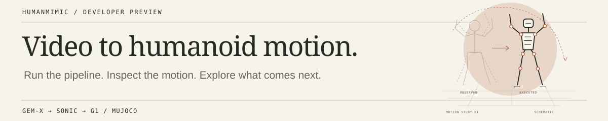
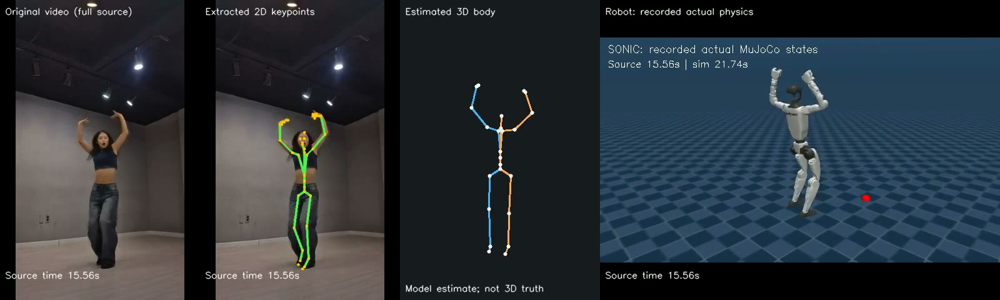
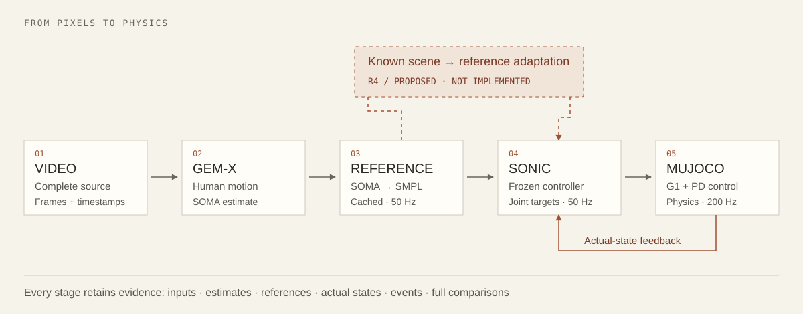

<p align="center">
  
</p>

<p align="center">
  <a href="#getting-started">Get started</a> &nbsp; · &nbsp;
  <a href="docs/usage.md">Usage</a> &nbsp; · &nbsp;
  <a href="#how-it-works">Pipeline</a> &nbsp; · &nbsp;
  <a href="docs/insights.md">Insights</a> &nbsp; · &nbsp;
  <a href="docs/troubleshooting.md">Troubleshooting</a>
</p>

# HumanMimic

**Turn a human-motion video into a G1 simulation you can inspect.**

HumanMimic connects GEM-X motion estimation, a pretrained SONIC controller and MuJoCo. Give it a short video; the pipeline extracts human motion, runs the robot controller, and saves a side-by-side comparison with the intermediate data and execution metrics.

**Developer preview · Simulation only · Manual environment setup.** Recorded-video and reference-motion workflows are implemented. Live camera input and obstacle-aware adaptation are on the roadmap.

## What you can do

- **Run a video through the full pipeline** — from the original frames to recorded robot execution.
- **Inspect what happened** — keep the motion estimates, controller references, actual states and timing in one run directory.
- **Work with cached stages** — reuse verified extraction data and preserve interrupted or failed attempts.
- **Evaluate and extend** — compare motion events and physical stability, then build on the same frozen controller.

<p align="center">
  <a href="docs/results.md"></a>
</p>

*Example output: original video → 2D/3D estimate → recorded robot execution.* This is a static frame from a complete 31-second run. [Source / creator](https://www.youtube.com/watch?v=gRexOgq8h-8) · [Results and full-media locations](docs/results.md)

## Getting started

### 1. Get the source

```bash
GIT_LFS_SKIP_SMUDGE=1 git clone --recurse-submodules https://github.com/LyrineYang/humanmimic.git
cd humanmimic
```

Already have a checkout? Use the [repository and handoff synchronization guide](REMOTE_WORK.md). The renamed repository is `LyrineYang/humanmimic`; verify the commit before resuming work on another machine.

The repository includes source, configuration, small demo images and results. Environments, pretrained weights, body-model assets and full videos are prepared separately.

| Your starting point | Next step |
| :--- | :--- |
| **Just exploring** | Browse the [demo and results](docs/results.md) or [pipeline](docs/architecture.md). No GPU or installation needed. |
| **Setting up a machine** | Follow the [setup checklist](docs/getting-started.md#prepare-a-runtime). The verified baseline is an 8 GB RTX 4060 Laptop under WSL2; a portable installer is not available yet. |
| **Runtime already prepared** | Use the video example below, then the [usage guide](docs/usage.md). |

### 2. Check your video

On a prepared, authorized execution target, choose a **single-person video up to 60 seconds**, with a fixed camera and visible full body and feet. Start with a simple gesture or squat.

```bash
source scripts/activate-r2.sh
python scripts/run-r2-video.py \
  --input /absolute/path/to/clip.mp4 \
  --run-id my-first-video \
  --check-only
```

This checks the input, storage and scheduling; it does not run a model or prove the runtime is ready. Continue only when `active_task_pids` is empty and `reserved_heldout_source` is `false`. Remove `--check-only` to run the pipeline. Optional `--events` annotations enable motion-event evaluation; without them, a demo can be generated but full acceptance stays unverified.

> **Current runtime status:** new execution on the original workstation is paused for Linux-server migration. Its boot guard also applies to `--check-only`. Use the [runtime readiness guide](docs/getting-started.md#prepare-a-runtime) before launching a run; source inspection and existing results remain available.

### 3. Open the output

A completed pipeline writes to `$R2_STORAGE_ROOT/runs/my-first-video/` (default storage root: `/mnt/d/humanoid-demo-r2`):

```text
my-first-video/
├── REPORT.md                    # Start here: outcome and artifact links
├── demo/comparison.mp4          # Original → estimated motion → actual robot
├── extraction/                 # Source, estimates and converted references
├── physical/                   # Actual states, controller logs and metrics
└── body-audit/                  # Tracking and motion-event evaluation
```

Review the report even when a video was produced: physical stability and correct imitation are separate checks. [Command options, output details and exit codes →](docs/usage.md)

## What works today

| Workflow | Availability | Verified result |
| :--- | :--- | :--- |
| Reference-motion tracking | Implemented | Five fixed motions, two trials each: **10/10 passed** |
| Recorded-video imitation | Implemented; offline | Held-out videos: **4/5 passed**; debug videos: **3/5 passed** |
| Live-camera input | Planned; camera testing needed | Not accepted yet |
| Scene-constrained adaptation | Research design prepared | Not implemented yet |

These are small engineering suites on the original 4060 environment. All ten current video rollouts were stable; three still failed motion-event checks. Full videos remain local, and all five held-out videos have been used. [Complete results and limitations →](docs/results.md)

## How it works



Perception runs offline in stages, then releases its models before the controller starts. SONIC turns the motion reference and robot-state history into joint targets; MuJoCo supplies the next physical state. The pipeline records what the robot actually did, alongside what it was asked to do.

[Architecture and source map →](docs/architecture.md)

## What we are learning

**A stable robot can still miss the gesture.** We keep event checks separate from physical stability, so a visually plausible rollout does not hide an imitation failure.

**Limited memory favors inspectable stages.** Separating extraction, control and rendering made the accepted offline workflow possible on an 8 GB GPU. The caches also make failures easier to locate and investigate.

The next question is how to adapt a demonstrated reach around an obstacle with a small budget of physical trials. The proposed approach edits the reference, screens candidates geometrically, then checks survivors with the frozen controller.

[Evidence-backed insights](docs/insights.md) · [Research questions and experimental design](docs/research.md)

## Documentation and contributing

| Need | Read |
| :--- | :--- |
| Prepare dependencies and assets | [Getting started](docs/getting-started.md) |
| Run a video or reference motion; inspect outputs | [Usage guide](docs/usage.md) |
| Understand a blocked run or an unexpected result | [Troubleshooting](docs/troubleshooting.md) |
| Find the code for a pipeline stage | [Architecture](docs/architecture.md) |
| Check successes, failures and evidence | [Results](docs/results.md) |
| Suggest a fix or explore an idea | [Contributing](CONTRIBUTING.md) |

Bug reports, clearer setup instructions and well-scoped experiments are useful contributions. Include your environment, command and relevant outcome so the work can be reproduced. Research ideas are welcome alongside practical improvements; [the contribution guide](CONTRIBUTING.md) explains how to separate a hypothesis from a demonstrated result.

<details>
<summary>Project operations and future website</summary>

- [Linux migration / R4 handoff](HANDOFF.md) — environment and asset transfer, in Chinese.
- [Current plan](PLAN.md) · [Experiment history](EXPERIMENTS.md) — authoritative research state and historical evidence, in Chinese.
- [Website design brief](docs/website.md) — local prototype and later hosting preparation.

</details>

## Acknowledgments and license

Built on [SONIC / GR00T-WholeBodyControl](https://github.com/NVlabs/GR00T-WholeBodyControl), [GEM-X](https://github.com/NVlabs/GEM-X), SOMA/SMPL representations and [MuJoCo](https://github.com/google-deepmind/mujoco). We reuse pretrained models; [UPSTREAM.json](UPSTREAM.json) records the integration boundary.

The repository is currently private and has no project-wide open-source license. Upstream code, models and videos retain their own terms. [Asset and attribution notes →](docs/getting-started.md#assets-and-attribution)
