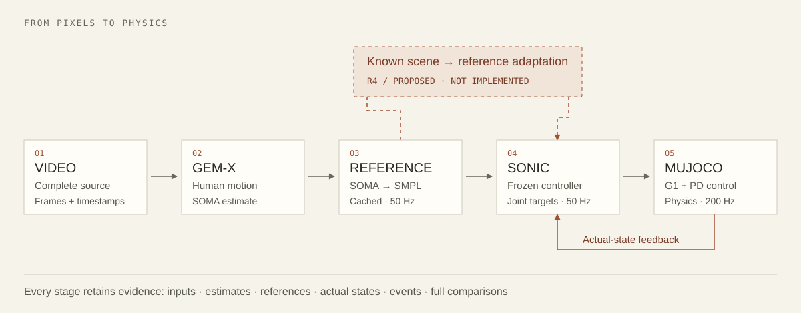

# From observation to execution

[Home](../README.md) / Architecture

## The accepted path

R1 feeds fixed G1 reference motions to SONIC. R2 replaces the reference source with a complete recorded video, estimated and converted offline. Both ultimately use the same frozen controller and physical simulator.

| Boundary | Representation and responsibility | Entry point |
| :--- | :--- | :--- |
| Source → frames | Original MP4, source SHA, PTS, complete 30 Hz normalization and selected-frame mapping | [r2_timeline.py](../scripts/r2_timeline.py) |
| Frames → human motion | Staged detection, tracking, 2D features/pose and GEM-X SOMA motion; persistent intermediates | [extract-r2-video.py](../scripts/extract-r2-video.py) |
| SOMA → reference | Explicit 77-joint public layout, SONIC SMPL24 convention, root orientation and 50 Hz resampling | [r2_smpl.py](../scripts/r2_smpl.py) |
| Reference → controller | Fixed initialization, cached Protocol v3 input, consumed-reference logging | [run-r2-physical.py](../scripts/run-r2-physical.py) |
| Controller → simulation | Pretrained encoder/decoder, joint targets, PD actuation and actual-state feedback over DDS | [Pinned SONIC](../UPSTREAM.json), [R1 runner](../scripts/run-r1-reproduction.py) |
| Execution → evidence | Actual-state body evaluation, events, native clock audit and full comparison rendering | [evaluate-r2-body.py](../scripts/evaluate-r2-body.py), [render-r2-demo.py](../scripts/render-r2-demo.py) |
| Evidence → acceptance | Per-run audit, source/freeze identity and complete suite summary | [audit-r2-run.py](../scripts/audit-r2-run.py), [summarize-r2-suite.py](../scripts/summarize-r2-suite.py) |

## Three quantities that must stay separate

**Reference** describes the intended motion. **Joint targets** are the controller's commands. **Actual state** is what the simulated robot did under actuation, gravity and contact.

The controller consumes reference information and robot-state history, produces joint targets, and receives subsequent actual states. R1 compares actual joints with the reference at the matching control time. R2's human-body reference is a different representation, so it uses body/event evaluation and timing audits; it must not reinterpret protocol placeholder joint fields as a meaningful joint target.

Control operates at **50 Hz**; the verified simulation path steps at **200 Hz**. These rates do not describe camera throughput. During accepted execution, the root is free, gravity and contact are enabled, and actual qpos/qvel are not overwritten by reference poses.

## Timing and initialization

R2 retains the original timeline and verifies the frame mapping used for 30 Hz normalization. Positions are resampled and orientations interpolated onto the 50 Hz reference grid. The declared initialization adds 50 hold frames and 100 transition frames before every unchanged original source sample; a trailing reference pad supplies future context. Source coverage and metrics are evaluated on source samples, with initialization monitored separately for falls.

Video synchronization follows recorded consumption and simulation time. No test-specific temporal shift is fitted to improve the comparison. Read [r2_initialization.py](../scripts/r2_initialization.py) and the native-clock checks in [evaluate-r2-body.py](../scripts/evaluate-r2-body.py).

## Why extraction and execution are separated

The accepted 8 GB workflow runs perception stages sequentially, writes caches, releases the perception process, then runs the controller and simulator. Rendering actual states is another offline stage. Caches are part of the reproducibility interface: source, implementation, model and output hashes must match before reuse.

This design enables offline inspection and recovery. R3 will need separate verification of concurrent perception/control, input freshness, camera dropouts and measured end-to-end latency.

## What the diagram's dashed branch means

The scene-adaptation branch is **proposed R4 work**. Known geometry would enter a reference editor before SONIC; candidates would be screened and then compared through closed-loop execution. The arrow does not indicate a currently available module. [Research design](research.md)

## Reading demonstrations correctly

| Artifact | What it proves |
| :--- | :--- |
| Estimated skeleton animation | The estimated reference can be visualized |
| Headless controller rollout | A controller actually drove physical simulation |
| Recorded-state playback | A visualization of a previously recorded rollout |
| Full comparison | Alignment and visible differences among source, estimate and execution |
| On-site camera test | Live perception/control behavior, only when measured with a real camera |

A rendered clip alone cannot establish control success. Acceptance binds it to recorded states, versioned inputs, metrics and a complete audit.
