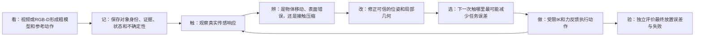
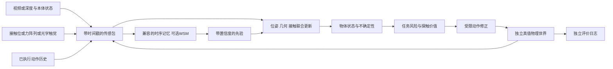

# R4 多模态物体重建与操作优化：WM-CraftNet源码审计、实施计划和实验设计

日期：2026-11-02。问题来自用户：用视频之外的触觉/接触力和WM-CraftNet多模态状态重建交互物体，并改善实际操作。沿用右LEAP、T1抬升保持/T2精密放置与开发/保留划分。本文第0节先解释研究主线，后文保留专项设计和历史记录；最新实现与运行状态见PLAN及第10节。用户要求后续实现不做CPU检查；当前复用V100独立环境做有界GPU就绪验证，不训练、不计费、不连接真机。MANO尚未收到可读取文件，不阻塞仿真主线。

**建议主线：维护带不确定性的显式物体状态，把多模态记忆作为先验，把真实接触作为修正证据，并用“预计能减少多少操作误差”决定精化/探触位置。** 首先回答几何更新相对直接力反馈是否有独立收益，再决定是否扩展/训练WSM。不是所有模态都能提供表面点，更不是预测图像越漂亮，控制就越准确。

对应机器可读协议：[r4-multimodal-study.json](../configs/r4-multimodal-study.json)。原几何基线和验收保留于[第一阶段方案](r4-stage1.zh-CN.md)，新增试验单独编号，避免把输入信息增加产生的收益混称为局部几何算法收益。

## 0. 先读这一节：推进什么，为什么，以及交付什么

### 0.1 一个贯穿全项目的例子

让LEAP把一个带凹槽的小物体拿起，平移80mm、转30°，最后放到目标位置。视频能告诉我们人手大致怎样抓、物体怎样移动；视觉粗模型可能把细凹槽抹平，手指又会遮住关键接触面。若指尖比预计提前2mm碰到物体，至少有三个解释：**表面位置估错了、整个物体移了、手指/接触在受力后产生了压缩**。直接把所有偏差写进网格，会把一次位姿错误永久刻成错误形状；只加大夹持力，也可能暂时拿住却放不准。

因此，本项目要建立一个可被新证据修正的操作循环：先看见并形成粗模型，记住之前看到/碰到的证据；再用小幅受控接触消除关键歧义；最后让更新后的模型真正改变动作，在独立物理世界中测最终误差。这里的“实际操作”首先指有重力、碰撞、关节执行器的动力学仿真，不是参考动画，也不是已完成真机实验。



### 0.2 核心insight：每句话对应一个可被否定的判断

**第一，模型应记住“证据与可信程度”，而不只输出一个漂亮网格。** 画面暂时被手挡住，不应马上忘记刚才看见的凹槽；但物体发生滑移后，也不能继续把旧位置当准确位置。我们把相对稳定的形状保存在物体自身坐标中，把不断变化的位姿、接触状态和误差范围单独保存。若没有新证据，位置不确定性应增长，不能因为重复看同一缓存而越来越自信。

**第二，接触最有价值的地方是帮助排除解释。** 接触不是额外的一张“真值图”。相同区域在不同载荷下的响应，加上独立视觉位姿证据，才能区分静态形状偏差、整体移动和有效顺应性。我们期待得到的是“这里需要向外修正约多少，证据支持到什么程度”；证据不足时，正确结果可以是“还不能判断”。

**第三，值得弄清楚的区域，由任务决定。** 凹槽边缘若决定指尖能否夹稳，应优先确认；与本次抓取、支撑和放置无关的背面，虽然可能更不确定，却未必值得花一次探触。我们要比较“减少全物体不确定性”和“减少当前任务误差”两种策略，不能只展示一个看起来合理的选点。

**第四，必须把几何收益和直接力反馈分开。** 带触觉的系统操作更好，可能只是它会松紧调节，而不是它重建得更好。核心证据是：已经开启相同力反馈后，再允许几何精化，是否仍改善最终精度。若没有，结论应是直接力反馈有效，不能把收益归给重建。

这些是研究假设；“视触觉融合”“主动探触”“神经场”本身都有已有研究。贡献是否成立，取决于上述对照能否支持机制和实际任务收益，而不是模块名称是否新颖。

### 0.3 多模态记忆到底怎样实现

先区分**要记住什么**和**用什么表示来记**。前者是问题本身，后者可以有两条实现路线。

| 记忆内容 | 直观解释 | 当前可解释实现 |
| --- | --- | --- |
| 对象身份与坐标 | 这是刚才那个物体，凹槽属于物体而不是世界中的固定点 | object_id/episode_id；物体坐标网格与世界位姿分开，换对象必须reset |
| 观测证据 | 何时从哪个传感器看见/碰到过什么 | 带采样/到达时刻、来源、有效标志的RGB-D、力阵列、关节和动作记录；重复帧去重 |
| 持久状态 | 到目前为止最合理的形状、位置和顺应性估计 | 局部网格参数、SE3、有效顺应性，以及可观测协方差和未确定方向 |
| 重要历史 | 最近几帧被遮挡时，仍能找回以前有用的证据 | 最多32关键帧，优化每次最多8帧；比较最近窗口与保留历史差异的选择方式 |
| 暂时未知 | 哪些推断已经过期，哪些方向还没有证据 | 失联时只保持预测并扩大误差范围，不能伪造深度/零力；过期状态不允许继续修正动作 |

当前采用的第一条路线是**显式证据记忆**：`r4_memory.py`保存观测与状态，P2对选中的不同证据重新求解。旧后验仅用于初始化，不再作为独立测量与重复观测相乘，所以同一帧不会被无限计权。重要的旧帧成对保留，避免用隔了很久的位姿强行解释一个短时接触。物体移动、遮挡和接触变化都留下记录，便于定位错误。这无需训练，并能直接用于LEAP。

第二条路线是**学习到的潜状态记忆**，例如WSM/RSSM。可把它理解成：网络把前一时刻内部状态、已执行动作和本次多模态观测压缩成新的内部状态；缺失标志和时间间隔告诉网络“这一刻没看到”，而不是“看到全零”。RSSM通常先用上一动作推进隐状态，再用当前观测更新随机状态。这个向量可能包含动力学、形状和接触线索，但它既不是现成网格，也不自动提供可靠置信度，仍需显式读出、测量一致性与校准。

**本项目没有把二者混称为已经完成的WSM。** 之前P2只有滑窗和上一解的初始化；本轮新增的是可审计的持久证据记忆。Sharpa原生WSM的22关节/5指输入不能补零直接迁到LEAP的16关节/4指。先用显式路线检验“记忆和接触是否有用”，再用E4检验原生WSM是否比同长度历史多提供了信息；只有确有瓶颈，才进入另行授权的E5训练。

### 0.4 接触怎样修正几何，而不把错误写进网格

一个接触包首先只说明：某个已标定指端区域在某时刻受到某个方向/大小的力。结合关节和腕部运动学，我们知道这个**手部区域**在世界中的位置；结合当前估计的物体位姿，才能把它放进物体坐标中。力分箱不能直接给出物体上的精确接触点，摩擦力方向也不能直接当表面法向。

随后同时比较三个解释：对象整体位姿是否应该改、该局部表面是否应该改，以及受力压缩是否能解释偏差。直观的一维式子是：

`观测偏移 ≈ 局部形状偏差 + 整体位姿偏差 + 有效顺应性 × 法向载荷`

例如同一区域从0.5N增加到1.5N，额外压缩约0.5mm，在位姿已独立约束、接触区域没有换位等条件下，才支持约0.5mm/N的有效顺应性；剩余静态偏移才可能支持形状修正。这是解释用的数值例子，不是本项目已经测得的材料参数。若只有一次接触、载荷没有变化，或者物体同时移动，这几项可能分不开，估计器应冻结混淆方向。

工程上，P2把视觉表面残差、接触区域/载荷响应、位姿观测和有限形变约束放进同一滑窗。只改变证据支持的局部法向网格位移；区域误差、噪声和失联显式进入处理。网格拓扑暂时固定，因此不能从球状粗模型凭空造出把手孔。真实仿真对象始终不改，更新的是算法内部模型；最终物理评价才能检验模型修改有没有价值。

### 0.5 任务相关探触怎样决定“下一次碰哪里”

先提出可达候选，再对每个候选问两件事：如果取得一次这样的观测，哪些状态不确定性可能缩小；这些状态变化又会怎样影响本次抓取/放置。二者组合成预计任务误差方差的减少，除以时间成本，再检查力、行程、关节和已有抓取状态的限制。预计增益为零或约束不满足时，选择不探触。

当前代码通过估计模型的抓取中心、接触间距和支撑高度等可微代理计算任务Jacobian，不手填真值梯度。它是可执行的首版近似，**并不保证降低真实操作误差**；接触切换和滑移会让局部近似失效，所以E3必须实际执行后比较。未校准的顺应性下界不能冒充安全预测；默认会拒绝依赖该假设的探触，而不是悄悄放宽2N预算。

### 0.6 与VideoManip的关系与区别

VideoManip论文的目标是从RGB人类视频重建手物轨迹，结合接触优化、交互抓取建模与演示合成，训练可操作的灵巧手策略。**它已经包含接触优化，不能把区别说成“它没有接触，我们加了接触”。** [论文](https://arxiv.org/abs/2602.09013)

本项目已读取的固定源码快照`9d0f286`发布了重建/重定向和可选ContactOpt包装；README明确将抓取数据/DRO训练与操作策略训练/评价列为尚未发布。这个发布状态描述的是该快照，不把它推断为作者没有做过论文里的工作。[固定版本README](https://github.com/hychen-naza/VideoManip/blob/9d0f286af35d73f4252d115d968e0a9c06542b9c/README.md)

| 方面 | VideoManip论文/已读发布代码 | HumanMimic当前主线 |
| --- | --- | --- |
| 核心问题 | 普通人类视频怎样转成可用于机器人学习的数据与策略 | 初始模型有误、遮挡发生时，怎样用执行反馈修正模型并改善精确操作 |
| 主要时间位置 | 从演示重建轨迹、合成数据、学习策略 | 执行前与执行中的状态维护、局部更新、受限动作修正和探触 |
| 接触的作用 | 重建/交互抓取优化中的接触一致性等 | 新的传感证据；同时区分位姿、几何、顺应性及直接力控制作用 |
| 记忆的作用 | 本项目不假定其拥有或缺少未审计的在线记忆模块 | 明确保存证据、对象状态和未知方向，单独做记忆消融 |
| 本阶段控制方式 | 原论文包含学习策略；下游发布流程不完整 | 固定参考＋有界IK/候选修正＋独立力反馈，不从零训练策略 |
| 判断是否成功 | 作者的抓取/任务成功率及论文设置 | 同硬件/参考/控制器下的几何误差、≤5mm/5°放置、失败惩罚、成功率与预算 |

两者可以组合：VideoManip负责提供视频中的粗模型和动作意图，本项目提供可审计的仿真执行、观测/真值隔离、在线修正与因果评价。我们补的是自己的下游实现，不声称恢复了作者未发布的DRO/扩散策略训练代码，也不拿不同任务的成功率直接宣称优于VideoManip。MANO、前端权重、实拍数据与本地网格/位姿模块仍是独立接入项。

### 0.7 每组实验到底回答什么、产出什么

| 实验 | 用直白的话说 | 公平比较与关键消融 | 交付物，以及不能据此声称的能力 |
| --- | --- | --- | --- |
| E0/P1 | 传感器真的测对了吗，哪些参数根本分不开 | 四指方向/载荷、无接触、多接触、掉点、延迟、饱和；恒载荷/缺位姿锚 | 标定曲线、事件日志、真实仿真录像；不等于能抓住物体 |
| E1 | 同一段经历，多了接触/连续力，模型有没有更准 | V、VB、VF；0/50/80%遮挡；pose-only/shape-only/去顺应性；相同记录和预算 | 网格/位姿时间序列、局部误差、1/2/5mm F-score、覆盖率、耗时；离线重放不能证明操作收益 |
| M1（E1扩展） | 改善来自真的记住了历史，还是只是多算/多看了数据 | single、recent、diverse；最近窗口和持久选择每次同为最多8帧、相同总点数/步数；对象切换、遮挡、重复帧 | 遮挡后恢复、漂移、错误融合/过度自信统计；single为诊断，recent/diverse才是等窗口主对照 |
| E2（主实验） | 几何变准是否在已有力反馈之外仍帮助操作 | G0F0/G1F0/G0F1/G1F1四组；相同初始化和参数，每组重新物理执行 | 所有成功/失败的实际误差、成功率、穿透/力与完整录像；主对比G1F1对G0F1 |
| E3 | 任务相关选点是否比随便碰/均匀碰/找最不确定处更值得 | no_probe/random/uniform/global_uncertainty/task_risk；同6次、3秒、2N上限 | 误差对探触次数/时间/冲量曲线、拒绝理由、实际增益与预测增益偏差 |
| E4 | 学到的WSM向量是否真的比原始历史多保存了有用信息 | 原生Sharpa同权重/读出容量，当前观测/同长度历史/h/h+观测/随机特征；打乱时间/移除动作 | 独立对象上的读出与扰动恢复结果；不是LEAP迁移或完整网格重建证明 |
| E5 | 哪个额外学习模块值得训练 | 冻结主干、小adapter、新头、有限微调；严格记录新增数据和成本 | 只有前述实验定位瓶颈后才开展；本轮未训练 |

核心E1为12开发对象×3种子×3遮挡×3模态=324重放；E2为12×2任务×3种子×4组=288物理试次；E3为12×2×3×5=360试次。M1/其他消融单列，不偷偷并入原预算；先做少量开发诊断，再冻结完整矩阵。对象是统计单位，种子和相邻帧不能冒充更多独立对象。24个保留对象仍未使用。

E2的主判断保持不变：开启相同直接力反馈后，局部几何更新使全样本惩罚位置误差至少降低20%，配对对象bootstrap的95%改善区间下界大于0，且成功率非劣于−5个百分点；失败按100mm惩罚并保留原始误差。若未达到，保留失败与不确定结论。E3还要证明用相同探触成本获得更多真实收益，不能以“选点图好看”过关。

### 0.8 从推进内容到最终能力

| 推进内容 | 希望获得的能力 | 可交付结果 |
| --- | --- | --- |
| P1传感桥与边界 | 知道什么时候、哪个区域、以什么可信程度碰到了物体 | 可复跑采集入口、校准文件、公开观测/私有真值、录像与失败日志 |
| P2＋显式记忆 | 遮挡后仍维护物体状态；不把位姿/压缩错误写成形状 | 带证据来源的局部网格、位姿、顺应性和不确定性；记忆/退化对照 |
| P3受限操作闭环 | 更新模型能影响关节和腕部参考，同时保留力限制 | 固定参数的四组控制入口、实际物理轨迹和E2全样本报告 |
| P4任务相关探触 | 在有限预算内主动获得最有操作价值的新证据 | 选点/拒绝/执行记录，E3实际精度与成本曲线 |
| P5/P6扩展与冻结 | 确定是否值得接入学习记忆，并检验跨对象泛化 | 原生WSM审计、冻结协议、未用保留集上的确认性结果 |

最终想交付的不是单次演示，而是一条可以解释失败原因的闭环：输入视频/参考和粗模型，输出所有执行记录、逐次模型更新及置信状态、最终几何与操作指标和可复跑入口。当前完整VideoManip前端、成功抓放、E2/E3收益及保留确认尚未通过；实现文件存在、数值检查通过、动力学任务通过是三种不同结论。

## 1. WM-CraftNet究竟已实现什么

本次固定并逐文件校验代码版本：`sharpa-robotics/WM-Craftnet@a1e825acaf50ade298e30b0b13c6671627af3a1e`（截至2026-11-02读取的main）。论文描述多模态预测状态用于策略上下文，而不是用潜空间想象直接进行规划；已有辅助几何目标，不能把新增一个几何头当作未经探索的新方向。[论文](https://arxiv.org/html/2609.07002v1)

以下具体结论来自源码而非论文性能推断；链接固定提交，完整源文件/Git blob核验存于本轮runs目录。

| 接口 | 实际代码事实 | 对本项目的影响 |
| --- | --- | --- |
| 可部署接触输入 | `compute_contact_observations()`读取指端净接触力范数，阈值化为5个接触位，并施加阈值扰动、延迟与掉点 | 原生输入不是稠密触觉图，也不是三维连续力；引入法向/切向力应单独列为新模态 |
| 低维状态 | `last_obs_buf`含22关节、本次配置的22目标、5接触位和24维重复旋转轴，总73维；WSM吃单步，actor堆叠历史 | 不能把全部内容误称纯proprioception，也不能按我们的16关节直接喂入 |
| 核心网络 | `WorldModelAdapter.step(prop,image)`在no_grad下做encoder/RSSM更新，输出512维确定性状态h；当前配置actor投影32维 | 论文写的16维与当前发布配置不同，以配置和实际state_dict为准；decoder使用含随机状态的完整feature，不能拿h直接冒充decoder输入 |
| 图像目标 | 输入为加噪、裁剪、归一化并翻转的深度；clean depth只作训练目标 | 输出是视角相关去噪深度，不是跨时刻物体坐标中的完整网格；预测深度与原观测相关，不能作为独立新传感器重复计权 |
| 位姿头 | `wm_pose_head`输出9维：平移3维+旋转6维；目标从仿真object root读取 | 这是训练监督，不是可部署物体位姿输入，也不是已经标定的位姿置信度 |
| 形状头 | `_compute_object_bps_vector`从已知mesh生成64个球内basis点到最近表面的位移，共192维；中心按顶点均值平移，尺度转换×100 | BPS是辅助几何编码；没有直接发布“任意多模态片段→带孔毫米网格”的接口，且canonical框架需单独核对 |
| 训练/部署分离 | pose、shape、clean-depth、更多接触标签在replay里，critic还用物体状态等特权信息；actor取可部署输入和WSM特征 | 我们必须把原始传感包与监督/评价包物理分开，不能借用root/contact坐标让重建看起来准确 |
| 当前默认reward监督 | `wsm/configs.yaml`的reward_head.loss_scale=0，当前build_wm_config也不覆盖它；两条配置路径的纯配置函数检查均为0 | 不能把论文的reward预测损失描述直接当当前有效训练目标；历史checkpoint是否用过其他配置仍未知，不能自行改权重后称官方复现 |
| 发布权重配置 | `example_ckpt/wm_craftnet_set_z.yaml`中pose/tactile/value/object四个辅助头为false；当前训练YAML对应为true | 不能直接宣称下载权重就获得完整版重建头；本轮未下载pth，二进制key/shape核验仍未做 |

定位：[接触与BPS生成](https://github.com/sharpa-robotics/WM-Craftnet/blob/a1e825acaf50ade298e30b0b13c6671627af3a1e/isaacgymenvs/tasks/wm_craftnet_rotation.py#L1594)，[多模态输入/训练目标](https://github.com/sharpa-robotics/WM-Craftnet/blob/a1e825acaf50ade298e30b0b13c6671627af3a1e/isaacgymenvs/tasks/wm_craftnet_camera_rotation.py#L2070)，[Adapter](https://github.com/sharpa-robotics/WM-Craftnet/blob/a1e825acaf50ade298e30b0b13c6671627af3a1e/isaacgymenvs/utils/world_model.py#L192)，[辅助头](https://github.com/sharpa-robotics/WM-Craftnet/blob/a1e825acaf50ade298e30b0b13c6671627af3a1e/wsm/models.py#L130)，[发布配置](https://github.com/sharpa-robotics/WM-Craftnet/blob/a1e825acaf50ade298e30b0b13c6671627af3a1e/example_ckpt/wm_craftnet_set_z.yaml#L279)。

另一个直接可改进的点：`RealtimeTactileReader.callback()`已拿到F6前三分量，但随后取范数并二值化，方向/载荷信息丢失；`get_contact_obs()`在初始化未完成或超过1秒失联时返回全零，让下游难以区分失联与无接触。优先比较连续力+接触位、显式valid mask与delta-time、原二值/失联置零三种表示。增加输入维度需匹配新adapter或训练，不能擅自改发布权重的输入形状。

部署入口也有区别：`wm_craftnet_infer.py`确实读取触觉后阈值化，接入深度与WSM；`wm_craftnet_policy_server.py`的示例contact_obs为零，不能拿后者声称运行了视触觉融合。这里只阅读部署代码，未加载SDK、未连接设备。[实际触觉读取](https://github.com/sharpa-robotics/WM-Craftnet/blob/a1e825acaf50ade298e30b0b13c6671627af3a1e/deploy/examples/wm_craftnet_infer.py#L799)，[server示例](https://github.com/sharpa-robotics/WM-Craftnet/blob/a1e825acaf50ade298e30b0b13c6671627af3a1e/deploy/examples/wm_craftnet_policy_server.py#L435)

## 2. 哪些研究空间值得优先做

| 方向 | 相对现有工作的具体问题 | 优先级与可否否证 |
| --- | --- | --- |
| 持久显式物体状态 | 将时序记忆约束为物体坐标中的形状、位姿和不确定性；测量是否减少漂移和错误拓扑更新 | 首选；若仅改善图像重建或pose、形状/操作不受益，就收缩结论 |
| 力、姿态、几何的解耦 | 接触位置变化究竟是形状误差、位姿漂移，还是传感器/接触顺应性 | 首选；固定载荷/无位姿锚必须报告不可辨识，不能靠强正则伪造确定答案 |
| 面向操作风险的主动探触 | 同样接触次数、力和时间，优先降低目标误差/滑落风险而非最大化全物体信息量 | 首选；必须胜过global uncertainty及直接力反馈，不能只胜过无触觉 |
| WSM的可解释读出与校准 | h是否保留形状/接触模式信息，误差不确定性是否可靠，预测是否跨动作/物体泛化 | 并行诊断；t-SNE或训练集线性拟合不能证明通用几何状态 |
| 增加连续力/滑移事件/一致性头 | 模型能否利用连续力与动作响应改善接触转移预测，而不是只学binary contact | 后续训练研究；先有传感与控制证据，再考虑训练小adapter或完整WSM |

**新意边界：** NeuralFeels已经做视觉/光学触觉的在线形状与位姿融合；主动触觉重建已有不确定性选点；TouchGuide已研究推理时以触觉引导动作。因此“加触觉”“加SDF”“加主动探索”单独都不足以支持原创性。我们的可检验切口是：在受限接触预算下，区分几何/位姿/顺应性的不确定性，选择能降低任务风险的证据，并通过对照证明实际精度收益的来源。现在是待验证假设，不宣称首创。[NeuralFeels](https://suddhu.github.io/neural-feels/)、[主动触觉重建](https://arxiv.org/html/2505.11975v1)、[TouchGuide](https://martelzhang.github.io/touchguide/)

## 3. 建议实现的状态和数据通路



对象状态设为 `b_t = {T_world_object, mesh_local_residual, covariance, contact_mode, slip_probability, friction_interval, effective_compliance, optional_memory}`。长期形状在物体坐标保存；位姿随时间更新；手型本体和传感器外参单独保存。遮挡/失联时扩大不确定性或暂缓形状更新，不能用网络预测填补后再当作确认事实。多物体切换要重置身份/关联，不能把前一个物体表面融合进下一个。

首版保持可解释、无需训练：视觉提供粗网格；以接触事件的局部形变更新最多2048个顶点，保留原观察/优化预算。用网格查询或缓存SDF计算表面/非穿透残差。之后才比较神经SDF：新增参数、训练量、时间都计入预算，不拿更多容量冒充融合优势。

### 3.1 四种传感条件必须分开

| 条件 | 可以约束什么 | 不能直接推断什么 |
| --- | --- | --- |
| V：RGB-D+关节/动作 | 可见表面、尺度、可观测位姿；RGB无深度另列 | 遮挡面真值、接触力、无锚定单目绝对尺度 |
| VB：V+二值接触 | 哪个已标定指端区域发生接触；结合探触轨迹形成区间约束 | 精确接触点、法向、力大小、密集触觉深度 |
| VF：V+法向/切向力阵列 | 载荷分布、接触模式、力约束；结合几何标定/载荷变化分离部分顺应性 | 仅凭力方向不能当作表面法向；接触力含摩擦，多接触也有歧义 |
| VD：V+光学触觉图/深度 | 标定后局部表面片、法向及接触区域 | 未标定时的绝对力、整物体表面；不能用模拟GT深度代替触觉估计而不声明 |

VF首选当前MuJoCo3.2.7已有的`mujoco.sensor.touch_grid`：按传感器坐标聚合力/力矩，通道为z/x/y，空间为角度bin，不是平面DIGIT像素。LEAP每个指尖的site、方向、传感面积和符号需要逐一标定。普通`touch`只输出区域法向力总和；`force`测子体与父体之间作用力，需考虑动力学/惯性，不能自动当指尖纯接触力。[3.2.7插件源码说明](https://github.com/google-deepmind/mujoco/blob/3.2.7/plugin/sensor/README.md)、[传感器语义](https://mujoco.readthedocs.io/en/3.2.7/XMLreference.html#sensor-touch)

当前`run-r4-physical.py`里的`mj_contactForce`及geom id用于评价记录。下一步传感桥应只向估计器交付经过区域聚合、噪声/延迟/饱和模型的sensordata；不交付精确contact.pos、contact.frame、物体真值pose、friction或CAD。模拟器负责生成传感读数，可以内部知道真值；算法边界不可以。

### 3.2 更新目标与可辨识性

采用滑动窗口求解，而不是单帧“看见接触就拉网格”：

`L = robust_visual_surface + contact_interval_or_patch + free_space_when_observed + pose_motion_prior + local_shape_regularizer + calibrated_force_response`。

- 点/片残差在估计物体坐标求SDF；光学触觉深度须扣除传感器基底和标定误差。二值接触采用已知指端表面区域/探触行程的区间约束，禁止把指尖中心硬当物体表面点。
- 无接触只有在传感器有效、覆盖区域明确、阈值已标定时才提供弱自由空间约束。掉点/失联/时延都不是“没有物体”。
- 先估位姿，再作受限局部形状更新；用联合Jacobian的秩/条件数检查是否能分离。没有足够证据就维持多个假设或扩大协方差，不强行更新。
- 简化探针模型为 `d = shape_offset + pose_offset + compliance × F_n`。无独立位姿锚时shape与pose具有相同列；恒定载荷时shape与compliance也混淆。需要独立视觉位姿证据和有限幅度载荷变化。有效compliance包括传感器、接触与对象，不能直接称物体材料刚度；MuJoCo接触求解器软化也不能当材料真值。
- 不滑动时，只得到 `mu >= |F_t|/F_n`的带噪下界；只有已知接触模式、足够激励与动力学条件下才讨论滑动摩擦估计。不能靠一次静态夹持同时确定完整形状、摩擦和刚度。
- WSM预测深度/触觉作为相关先验或候选，而不是另一份独立测量。先验与观测发生持续冲突时降低先验权重，保留冲突事件；不把hallucination闭环强化。

### 3.3 如何利用WSM而不假装跨手型直接迁移

**路径A（现在可独立开发）：** LEAP观测→显式状态融合/局部几何→固定规划器/力反馈。保留可选memory接口，先不用未经验证的Sharpa权重。这条路径检验多模态信息是否足以改善R4操作。

**路径B（与WM-CraftNet直接有关的机制研究）：** 在其原生Sharpa 22DoF/5指输入上，冻结已发布WSM，导出h、完整posterior feature、深度重建、动作历史以及隔离的评价标签。比较raw history、h、h+原始传感器能否读出物体位姿/局部shape/contact transition；先做可观测性和泛化审计，不要求原策略完成我们的LEAP放置任务。现有`_record_wm_feature_snapshot()`可作记录切入点，但它附带的object标签只能进入监督/评价文件。

**路径C（有数据和训练授权后）：** 为LEAP训练或适配手型无关的接触token（传感器外参、区域、力、缺失mask、时间），把h作为状态转移先验；新增 `g(x_object,h)` 的局部形状/不确定性读出与连续力/接触事件预测。shape更新与操作风险耦合，保持原decoder/策略对照。不能将16关节补零到22维当作完成迁移；action-conditioned动力学还依赖手型、力学和采样频率。

实现时，decoder需要`dynamics.get_feat()`的完整feature；以当前32×32随机状态和512确定性状态计为1536维，actor只使用h的投影。BPS头如果在checkpoint里不存在，新建随机头并非已有重建能力。需要先列出state_dict key/shape、配置差异、归一化、相机裁剪、contact阈值和dt，匹配后才运行。

### 3.4 如何用重建优化动作

保持原规划器/低层控制参数；几何更新只影响候选接触、IK可行性与规划模型。控制器每周期可以依据已标定力限制增加/减小夹持或短暂回撤。对估计状态的多个后验样本评估目标误差、滑落/碰撞风险，以保守分位数筛掉不稳妥候选；物理执行世界始终保持同一独立真值，不随估计网格修改。

探触选择采用预计任务误差方差减少：`U(a) = tr[J_task (Sigma - Sigma_after(a)) J_task^T] / time(a)`，并过滤不可达、预测接触力过大与破坏当前稳定抓取的候选。J_task通过**估计规划模型**的小扰动/有限差分获得；禁止用真值几何或最终执行结果倒选ROI。所有候选对当前任务的信息增益为零时，选择不探触。线性Gaussian只是首版近似；滑移/换接触等非平滑事件另用候选rollout估计。

若一个背面区域很不确定却不影响当前放置，global uncertainty会优先探索它；任务加权策略应优先查清决定抓取偏置/支撑稳定性的区域。这个例子是可测试的选择差异，不是已经证实的成功率收益。

## 4. 开源组件与具体代码分工

| 组件 | 采用方式/具体位置 | 当前状态与限制 |
| --- | --- | --- |
| WM-CraftNet（Apache-2.0，资产另有条款） | 上述Adapter、RSSM、BPS、feature recorder作机制审计；后续独立Python3.8/Torch2.1cu118/Isaac Gym环境 | 源码已核验；没有下载/执行权重，不混入r4-core |
| NeuralFeels（MIT） | 固定`36398b8`的`modules/loss.py`中ray/normal/free-space残差、`PoseOptimizer`的SE3优化、`SDFNetwork/SDFInterp`分离形状/位姿 | 参考和适配接口；完整库未安装，不声称复现。其DIGIT光学触觉与LEAP力阵列不是同模态 |
| MuJoCo3.2.7 touch_grid | 传感器生成、标定与force-grid阶梯对照 | 本机CPU法向力探针已通过；LEAP指端外参、剪切方向与多接触尚待验证 |
| NumPy/SciPy1.13.1 | 稀疏状态/协方差、局部可辨识性、稳健least_squares；小原型无GPU依赖 | 已在r4-core运行；大规模状态估计需再测耗时 |
| PyTorch2.5.1cu118 | 后续批量SDF/局部形变、Jacobian和WSM-compatible adapter | V100核心已通过，不代表新模型/扩展已通过 |
| TACTO（MIT） | 若采用VD轨道，生成/读取DIGIT式光学触觉，与FeelSight对照 | 官方接口以PyBullet为主；不默认为MuJoCo开箱即用，不将触觉渲染当弹性力学标定 |
| Trimesh/CoACD | 粗几何/局部mesh处理与规划碰撞代理 | 沿用已有入口；碰撞近似误差单独报告，不能让凸包填孔制造接触收益 |

NeuralFeels定位：[loss.py](https://github.com/facebookresearch/neuralfeels/blob/36398b861c05a66868490fa43dfb7742cf345386/neuralfeels/modules/loss.py)、[pose_optimizer.py](https://github.com/facebookresearch/neuralfeels/blob/36398b861c05a66868490fa43dfb7742cf345386/neuralfeels/modules/pose_optimizer.py)、[model.py](https://github.com/facebookresearch/neuralfeels/blob/36398b861c05a66868490fa43dfb7742cf345386/neuralfeels/modules/model.py)。其他：[SciPy接口](https://docs.scipy.org/doc/scipy-1.13.1/reference/generated/scipy.optimize.least_squares.html)、[TACTO](https://github.com/facebookresearch/tacto/blob/a21d0c4626d74a546d94859226c2fea348babb6a/README.md)。

V100注意：NeuralFeels模型指定FullyFusedMLP，tiny-cuda-nn对SM70及以下会走CUTLASS路径；不能宣称完全不支持，也不能沿用RTX基准速度。本轮未编译它。先用已有Torch/SciPy，不升级驱动、不默认采用CUDA13；未来独立构建、用SM70实际数值和峰值显存验证。[tiny-cuda-nn构建逻辑](https://github.com/NVlabs/tiny-cuda-nn/blob/3daa6e5b8b8e0fa17971a1a20acfbb3754494b38/CMakeLists.txt)

## 5. 数据：现有DexYCB为什么不够

1. **R4-LocalGeom-v1仍是因果主数据。** 保留既有12开发、24未用保留实例；新传感包来自固定动作/传感布局，不直接导出真实表面接触点。按对象/实例分组；所有相邻帧、同物体不同传感器/扰动版本归在同一split。
2. **DexYCB保留视频桥接角色。** 它不是现成同步机器人触觉/力实验集。不能把MANO接触推断或标注CAD当真实触觉，不能用它直接验证VF收益。
3. **FeelSight新增为视触觉感知外部验证。** 官方70段（30实拍、40仿真），RGB-D、Allegro/DIGIT触觉和本体数据，适合形状/位姿融合；不是LEAP控制数据，也没有据此确认的校准三维力/摩擦真值。数据卡许可标MIT，第三方对象资产另核对。[官方数据卡](https://huggingface.co/datasets/suddhu/Feelsight/blob/main/README.md)、[数据结构](https://github.com/facebookresearch/neuralfeels/blob/36398b861c05a66868490fa43dfb7742cf345386/data/README.md)
4. FeelSight下载先读manifest，按规范化object identity分组：按SHA256(object_id)固定排序，前25%对象开发，余下对象保留；同一对象的sim/real/遮挡序列不得跨组。小样本至少各2对象，否则不作泛化结论。冻结实际ID清单后才读取保留序列，报告已有预训练模型是否见过这些对象；不把“本项目没看过”自动称为预训练未见。
5. 今晚没有下载大数据。首批只取开发对象并限制新增5GiB；官方完整数据规模超过当前剩余准备额度时先调整具体下载清单，不悄悄拉全量。原MANO受限文件存仓库外，记录哈希/路径，不把账号或资产提交Git。

## 6. 探究实验：把收益的来源拆开

### E0：传感语义和可辨识性（本轮已做的CPU诊断）

- MuJoCo原生touch与3通道4×4 touch_grid，50g物体在平面上500步静置；两者最终法向力均为0.4905N。只证明该受控传感配置，不是LEAP实机或剪切力标定。
- 局部线性合成fixture同时含3mm几何偏移、2mm位姿偏移及1mm/N有效顺应性；变载荷+独立位姿锚可恢复参数，无位姿锚/恒定载荷必须返回unobservable。这是解析自检，不是研究精度结果。
- 任务信息增益选择与global uncertainty不同；超力/不可达候选被拒绝。静态摩擦仅返回下界；原始传感契约拒绝GT字段、未来时间、错误坐标及把force冒充surface。

### E1：固定轨迹的感知对照

每个开发对象×3执行seed，采一条不依赖待比较方法的预定探触轨迹；V/VB/VF共享视觉、本体、动作和相同传感器噪声实现。视觉遮挡比例0/50%/80%，共12×3×3×3=324次离线重放。VD在FeelSight单独测，不用额外光学信息替代VF再混入统计。

对照：pose-only、shape-only（独立固定pose估计）、joint pose+shape；加入时间打乱/指端错配/掉点当零/恒载荷等诊断。shape-only的“固定”指每帧各自的位姿保持不变，不是把运动物体放在同一个初始姿态：若每帧有独立位姿测量则直接冻结；否则用原始粗模型和视觉先做独立pose-only估计，随后冻结逐帧结果。该准备路径不访问触觉、精化网格或joint记忆缓存；视觉估计与形状更新共享原有200步/300秒预算（无完整位姿测量时每窗口先分配一半步骤给位姿）。缺帧/退化不能获得可观测位姿时，返回`independent_pose_unavailable`并计入拒绝分母；不以初始姿态兜底。形状协方差是给定这些估计位姿后的条件量，不是消除了位姿不确定性。

VB在`r4_modalities.py`中转换成只含每个触觉单元接触位、时刻、已知手部外参和健康状态的输入，之后才进行记忆选择与拟合；过预算按固定空间索引采样，不按力大小/方向选点。此VB是二值触觉图，不等同于Sharpa的原生5位接触。V在记忆选择前剔除触觉，避免通过关键帧选择间接泄漏。变更连续力但保持接触位与健康不变时，VB的选点、记忆与求解应一致。

主指标为可见/遮挡/接触ROI表面距离中位数/P95、F-score@1/2/5mm、pose平移/旋转误差、尺度、后验覆盖率和不可辨识拒绝率。评价真值从实体并集的暴露外边界采样：恰好相接部件的内部公共面不能加入Chamfer/F-score；通过沿已知面法向朝外偏移并检查是否进入自由空间来剔除它们。有限点采样误差仍需报告。覆盖率必须在开发校准、保留只检验；帧数不是独立样本数。

它只回答感知/状态问题。离线复放同一条轨迹不能证明闭环策略会成功，也不能用最后一帧真值反过来选ROI。

### E2：几何更新与直接力反馈的2×2对照（主操作实验）

| 组 | 几何更新G | 力反馈F | 隔离的作用 |
| --- | --- | --- | --- |
| G0F0 | 冻结粗几何 | 关闭 | 原操作基线 |
| G1F0 | 多模态局部精化 | 关闭 | 几何引起的动作改变 |
| G0F1 | 冻结粗几何 | 开启 | 直接力反馈即可获得多少收益 |
| G1F1 | 多模态局部精化 | 开启 | 两者结合及交互 |

四组使用同一已实现/冻结的规划器、控制权重、初始动作、传感器、初始状态与种子；仅开关指定分支，pose估计器固定同一算法，另测pose-only控制。闭环后轨迹与传感读数当然可以不同，因此每组必须重新物理执行，不能复用另一组成功视频。也不能为了让G1成功而单独调PD、摩擦或增大力上限。

12开发×2任务×3seed×4组=288次；未来24保留对应576次，当前未运行。T1/T2沿用80mm抬升/2秒、80mm平移/30°、松手静置1秒、≤5mm/5°及≤2mm穿透。增加接触力P95/峰值、饱和率、滑移距离、总冲量、拒绝、时间和计算消耗；不是只报成功片段。

**主对比为G0F1与G1F1**：有直接力反馈之后，几何更新是否仍使全样本惩罚位置误差降低≥20%、配对对象bootstrap 95%改善区间下界>0，且成功率非劣于−5个百分点。失败计入100mm惩罚和分母，原始误差同时保留。若G0F1已解释全部收益，则应结论为力反馈有效，而非几何精化得到验证。另报告G1F0与G1F1及交互项，不能据探索性多重比较挑一个p值；探索性多重比较采用Holm校正。24个对象可能无法得到足够窄的区间，证据不足就保留不确定结论，不把72个seed运行当72个独立对象。

### E3：同预算主动探触

比较no_probe、random、uniform、global_uncertainty、task_risk_reduction，固定最多6次接触、累计3秒探触、预测探触力≤2N；探触计入原12秒episode和300秒方法/对象墙钟预算，no_probe获得相同总控制时间。力阈值为开发协议，冻结前先核验任务可达，不能看保留失败后放宽。

12开发×2任务×3seed×5策略=360次。以操作误差/成功率对接触数、时间、冲量的曲线和面积比较，不只比最后网格。关键消融：任务Jacobian置为单位阵、去风险/可达过滤、只改pose、冻结形状、去顺应性项、假定已知摩擦、错配/延迟触觉。先做开发小矩阵定位失效，再冻结少数确认性对比；不全因子爆炸。

### E4：WSM记忆是否提供了额外几何信息

在原生22DoF输入上固定权重，比较当前观测、等长度历史、h、h+原始观测、随机固定feature。读出容量/训练对象和拟合预算相同，严格对象/轨迹分组；训练标签仅来自监督包，测试时输入不能包含标签。报告heldout读出误差、校准、延迟和扰动恢复，检查模态缺失、时序打乱、动作条件移除。若h不优于历史，优先采用显式融合，不必为使用世界模型而使用。

原代码已有feature recorder，但没有本项目需要的完整可复用数据集；今晚没有导出或执行WSM。读出拟合及原生环境运行待相应资源安排。不要把原生Sharpa旋转成绩与LEAP放置成绩直接作为方法优劣比较。

### E5：必要时才训练的新头

先从接触事件/滑移概率、连续normal/shear、局部geometry uncertainty小头开始；对照固定WSM、仅adapter、微调encoder/RSSM。加入几何-接触一致性、动作后的力/位姿预测残差、缺失mask和时间差；不要用部署时无法获得的干净深度/真值contact作为网络输入。只有E1–E4显示瓶颈确实在表示时才值得安排训练；当前不执行。

### E5落实到上游代码的修改位置（计划，尚未修改上游）

1. `wm_craftnet_rotation.py::compute_contact_observations`保留原binary路径，同时在传感器坐标输出经过噪声/饱和模型的连续力、valid、age；监督端的精确碰撞信息仍隔离。真实输入适配对应`RealtimeTactileReader`，保留F6信息和有效性，而不是立刻取范数/二值化。先验证坐标、单位和触觉通道顺序，不接真机。
2. `world_model.py::WorldModelAdapter`的obs_shape、step、append和replay采样共同新增force/mask/dt；`wsm/configs.yaml`的encoder/decoder `mlp_keys`当前是`.*`，但obs_shape只声明prop/image；新增字段要同步obs_shape，并将encoder改成显式可部署字段白名单，防止误把监督标签编码进去，decoder按需预测。不能只往dict里加键却没有进入网络。序列的动作a(t-1)、观测o(t)、reset flag和未来预测标签必须对齐。
3. `wsm/models.py::WorldModel._train`增加连续力均值/有下限方差的NLL、未来接触转移/滑移事件头；已有触觉BCE及其类别平衡保留作基线。Force目标来自声明的传感模型，滑移真值若用于监督则只在训练标签文件；部署用预测值。时延/缺失mask随机化与force量程随机化单列消融。
4. 增加以物体坐标x和posterior feature为条件的几何读出，损失含局部观测、一致性及不确定性校准；优先用冻结主干+小读出比较，再考虑主干微调。旧BPS192维辅助头保持对照，测是否只是增加容量。另把reward loss的0/非零作为明确的配置实验，记录原有效值，不能悄悄将其开启。对称物体的旋转等价、尺度锚与identity切换写入评估；完整SDF不由一张去噪深度自动得到。
5. 几何-力一致性只用适合接触模型的约束：接触区域、允许顺应性的间隙/载荷关系、摩擦锥和动作响应；不能简单强迫总力向量平行SDF法向。预训练旋转reward/value不能直接当精密放置价值，外部任务目标仍由R4评价定义。
6. `network_builder.py`保留原`wm_feature_encoder`和原actor为冻结对照。若新增显式状态/不确定性特征，需新adapter/策略训练并报告额外数据；当前可先在外部候选筛选/受限残差控制中使用几何，不假装旧actor自动理解新特征。

这些改动不是今晚已训练的模型。先用E4检查发布特征的信息量，再用E1–E3确定有价值的新增信号；只有据此选择的小范围训练才值得分配后续计算资源。

## 7. 可执行工作包与验收

| 顺序 | 要修改/增加的具体位置 | 输出与通过条件 |
| --- | --- | --- |
| P0 历史原型，已归档 | 旧CPU诊断已由P1/P2/P4 CUDA实现替代 | provenance/时序/模态边界、局部可辨识性、探触价值计算、原生传感探针；不是完整系统 |
| P1 传感桥 | 给`r4_scene.make_scene`增加独立选项的指端sites/sensors；`run-r4-physical.py`导出sensor packet和独立GT日志 | 四个LEAP指端逐一验证方向/力、无接触/多接触/时延/饱和；策略代码不能读GT；默认旧入口不变 |
| P2 显式状态 | 新增object belief、contact onset区间、SE3/局部mesh滑窗优化 | 先固定轨迹E1；可见/不可见/退化/失联均有预期输出；协方差覆盖率而不是optimizer.success作为可信度 |
| P3 操作闭环 | 接现有VideoManip参考契约；实现固定IK/候选规划器、力反馈开关 | 先oracle任务可达和负对照，再E2；所有组相同权重/预算，不改独立执行真值 |
| P4 主动感知 | `r4_probe.py`从估计模型获得J/可达性/力预测 | E3同预算胜过不确定性策略才支持任务相关探触；原型手填J不算通过 |
| P5 WSM桥接 | 独立配置/权重审计；导出adapter的h/posterior/观测，隔离标签 | E4原生输入与丢失模态验证；LEAP迁移另验，不静默partial-load或补零 |
| P6 确认性协议 | 两份轨迹/对象清单、代码/资产/控制器冻结、运行预算表 | 完成开发审计后才启动保留；此研究/设计交付不授权现在运行正式矩阵 |

V100未来建议仍是一张卡、8CPU线程串行开发；50Hz低层控制、10Hz状态更新、2Hz几何更新是待测目标，不是已达性能。初始只允许1个场景和短片，先测P50/P95耗时与显存，再增加候选。不得拿本轮0.06秒的小诊断推算神经场或Isaac Gym吞吐。

## 8. 前一轮CPU原型与历史复跑记录

该原型已由P1触力桥、P2 CUDA联合估计、P4探触模块替代。2026-11-02清理时确认没有当前运行模块引用，移除了`r4_multimodal.py`、`check-r4-multimodal-cpu.py`和`test_r4_multimodal.py`共三个文件，不再提供CPU研究复跑入口。当前入口见第9节及[使用指南](usage.md)。

历史源码与结果身份保留在本地存档tag `archive/server-research-20261102`（提交`3c6d3f0264cb5efefbefcfce934af31386efb669`）；例如`git show archive/server-research-20261102:scripts/r4_multimodal.py`可只读追溯。用户要求不运行CPU数值检查；本次清理未执行旧原型。

结果：30项测试通过（原17项+新13项）；500步CPU传感探针通过，法向力0.4905N与预期重力一致；可辨识/不可辨识和候选拒绝按预期工作。完整结果在 `runs/r4-multimodal-design-20261102-01/`，小摘要见[evidence](../evidence/r4-multimodal-design-20261102.json)。

此前这些只完成源码研究、协议与CPU原型验收。后续P1/P2源码状态见下一节；成功抓放、WSM推理、完整SDF、现场相机和正式保留结果仍未交付。原R4操作精度和多模态收益均为awaiting_verification。

## 9. P1/P2实现与GPU运行准备（2026-11-02）

本轮用户要求直接实现P1/P2，不做CPU检查；因此完成代码与人工源码审阅，没有运行Python解析、pytest、CPU探针、GPU推理或实验。下表是实现范围，不是通过证明。新增验收全部`awaiting_verification`，原始准备记录在`runs/r4-p1p2-implementation-20261102-01/`。

| 环节 | 已写入实现 | 待GPU运行确认 |
| --- | --- | --- |
| P1四指触力桥 | `r4_sensor_bridge.py`；可选16×12×3 touch_grid，四个远端指节sites；xyz有符号作用力、传感FK、采样/到达时刻、丢包/饱和 | 四指方向/载荷、多个接触、时延、饱和，以及完整手部的区域误差 |
| 观测/真值隔离 | `public-observations/{calibration.json,observations.jsonl}`与`private-evaluation/`分开；严格字段白名单；单独估计进程通过stdin/stdout交换JSON | 实际worker依赖加载、访问拒绝、自检与真值改写不变性 |
| P2显式状态 | `r4_belief.py`：CUDA FP64 SE3、多帧共用局部法向网格残差、非负有效顺应性；可观测性/协方差/接触事件输出 | 精度、退化行为、拟合与投影后残差、经验覆盖率、耗时/显存 |
| 开发实验 | 同记录V/VB/VF与pose_only/shape_only/rigid_contact；0/50/80%遮挡；独立GPU几何/相对位姿评价 | E1固定轨迹数据、324核心重放、消融结果；不等于E2操作收益 |

**传感语义。** `touch_grid`的3通道来自原生z/x/y顺序，公开输出转为传感器xyz中作用于手的力；分箱方位是`atan2(x,-z)`，俯仰是`atan2(y,sqrt(x²+z²))`，不是DIGIT平面像素。依据[MuJoCo 3.2.7实现](https://github.com/google-deepmind/mujoco/blob/3.2.7/plugin/sensor/touch_grid.cc)核对符号、焊接刚体范围和分箱；源文件留在本轮run目录。

插件测量整个焊接远端指节，不只外观指垫。标定因此包含其全部已知可碰撞手部几何，绝不包含对象CAD。CUDA标定每个分箱的九条射线，保留已知手部表面近/远交点、范围和法向一致性；多层/跨边/无效区域会被拒绝。得到的是带误差的手部接触区域，不是对象真实接触点。有限射线范围仍需P1实测校准，不能用该近似宣称亚毫米接触定位。

失联和过期样本保持unknown，不变成零力；削顶力不作为等式更新。首次接触记录上一次有效无接触与本次接触之间的时间区间，失联会打断该区间。无接触当前只作状态输出，不擅自清空对象占据空间。候选对象接触通过估计模型邻近与法向对向门控，不能用真值对象ID筛掉不利的手自碰撞/地面接触；这种关联仍需开发数据检验。

**P2模型。** 使用粗网格上有限个局部RBF法向位移，显式移除形状中的六个刚体规范自由度，联合优化最多8帧位姿和一个窗口有效顺应性。默认24形状模式、4096观测、2048顶点、5mm位移上限；每次记录重放共享200次梯度更新/300秒拟合预算，不是每窗口无限追加。变形面翻转或退化会拒绝更新。该表示保留初始拓扑，不能从球状先验凭空重建把手孔洞；它是局部网格精化，不是已完成任意拓扑神经SDF。

视觉残差来自观测点和局部有向面近似；连续力残差为接触区域的表面距离加有效顺应性×法向载荷，区域尺寸进入噪声。VB使用接触区间，不伪造力值。力没有足够变化时，joint退回区间约束、冻结顺应性；数据Fisher矩阵不含正则项，低信息方向投影冻结，并输出null projector。伪逆协方差只覆盖可观测子空间，null方向的不确定性无界；不是把零特征值变成零方差。协方差采用CUDA FP64有限差分信息近似，必须另做覆盖率；不能据优化器收敛或满秩声称可信。

位姿锚只允许独立fiducial或明确的synthetic fixture，不能把相同点云配准再次当独立测量。`friction_interval`与`slip_probability`目前为null，因为力本身不足以证明粘着、识别摩擦或校准滑移概率。顺应性是有效接触响应，不能直接称材料弹性模量，MuJoCo软接触也没有可直接作为该标量的真值。

**隔离边界。** 仿真采集进程是可信传感生成侧；估计器只接收校准、粗先验和公开帧，既不接收模型/data对象，也没有真值路径。worker禁止项目数据文件读入、文件写入、子进程和网络，提供访问拒绝自检；源码不导入MuJoCo或私有评价模块。Python audit hook用于防止项目代码意外泄漏，不是防恶意原生扩展的OS沙箱；相同用户身份下目录0700本身也不是隔离证明。GPU检查会改写私有标签并比较全部估计状态、协方差和目标轨迹；声明来源仍不能防止人为把真值冒充传感观测，需要保持采集端审计。模拟RGB-D使用渲染instance mask，明确标记`simulated_rgbd_with_instance_mask`，不是已实现实拍分割。

**V100运行顺序。** 复用现有Python3.10/Torch2.5.1+cu118/MuJoCo3.2.7环境，不安装依赖或更改驱动。显式选择当前空闲GPU UUID与对应物理EGL编号，先检查活跃任务和日志；不要重用历史“GPU3空闲”的结论。代码遇到CUDA缺失直接拒绝，无CPU后备。所有以下命令本轮均未执行。

```bash
source scripts/activate-r4.sh
# 检查实时占用后设置；下列占位符必须替换。
export CUDA_VISIBLE_DEVICES="GPU-当前空闲设备UUID"
export MUJOCO_EGL_DEVICE_ID="对应物理编号"
export CUBLAS_WORKSPACE_CONFIG=:4096:8
export R4_P12_RUN="$R4_DATA_ROOT/runs/p1p2-$(date -u +%Y%m%dT%H%M%SZ)"

# 首先跑四个真实LEAP远端指节的接触/载荷校准，再跑独立解析几何联合估计。
python scripts/check-r4-p1-gpu.py --output "$R4_P12_RUN/p1"
python scripts/check-r4-p2-gpu.py --output "$R4_P12_RUN/p2"
# 覆盖率是独立的20种子试验；不复用已存在目录。
python scripts/check-r4-p2-gpu.py --coverage --output "$R4_P12_RUN/p2-coverage"
```

P1入口会生成四指端实际物理录像；它是MuJoCo CPU动力学/原生插件加NVIDIA EGL、CUDA数值判定，不是GPU物理引擎。本轮没有执行它，也没有用CPU版跑通代替验收。四个自由远端指节的加载试验只是传感校准的一部分，完整LEAP上的接触区域与自碰撞关联还需固定动作试次。P2入口使用独立椭球/载荷合成观测，不冒充LEAP操作；覆盖率检查同时覆盖xyz平移和顺应性，无输出/不可观测试次仍计入分母。

真实固定参考采集、估计与独立评价：

```bash
# R4_REFERENCE、R4_EVALUATION_SCENE 为已准备的同一调试/就绪任务。
python scripts/run-r4-physical.py --reference "$R4_REFERENCE" \
  --evaluation-scene "$R4_EVALUATION_SCENE" --sensors --render \
  --output "$R4_P12_RUN/collection"
python scripts/prepare-r4-prior-gpu.py \
  --observations "$R4_P12_RUN/collection/public-observations" \
  --output "$R4_P12_RUN/coarse"
python scripts/run-r4-belief-gpu.py \
  --observations "$R4_P12_RUN/collection/public-observations" \
  --prior "$R4_P12_RUN/coarse/prior.json" --modality VF \
  --output "$R4_P12_RUN/belief"
python scripts/evaluate-r4-belief-gpu.py \
  --belief "$R4_P12_RUN/belief/belief.json" --prior "$R4_P12_RUN/coarse/prior.json" \
  --evaluation-scene "$R4_EVALUATION_SCENE" \
  --actual-state "$R4_P12_RUN/collection/private-evaluation/actual-state.npz" \
  --output "$R4_P12_RUN/evaluation"
```

自动粗模型入口仅从首个有效RGB-D帧构造PCA椭球，是有遮挡偏差的通用起点；可以用同一schema提供更好的观测粗网格，不能用evaluation CAD代替。当前物理评价支持已有四类开发对象的box/cylinder并集。报告世界表面误差、1/2/5mm F-score、固定先验ROI、相对SE3运动误差及拒绝/不可观测数量；点采样存在有限分辨率偏差。不同初始物体坐标规范不直接比较绝对CAD位姿，世界表面指标仍保留初始偏差。操作最终≤5mm/5°、失败100mm惩罚等原门槛留给E2，E1几何误差不能替代它们。

E1索引示例（路径替换为已有记录，object_id必须属于开发对象；一对象一个执行种子一条记录）：

```json
{"split":"debug","records":[{"object_id":"stepped_prism-101","seed":1101,
  "observations":"/absolute/collection/public-observations",
  "prior":"/absolute/coarse/prior.json",
  "evaluation_scene":"/absolute/evaluation.json",
  "actual_state":"/absolute/collection/private-evaluation/actual-state.npz",
  "collection_manifest":"/absolute/collection/manifest.json"}]}
```

```bash
# 只生成冻结清单；--execute 才运行，使用不同输出目录。
python scripts/run-r4-e1-gpu.py --records "$R4_E1_RECORDS" --output "$R4_P12_RUN/e1-plan"
python scripts/run-r4-e1-gpu.py --records "$R4_E1_RECORDS" --execute --output "$R4_P12_RUN/e1"
```

36条对象/种子记录×3遮挡×3模态=324次；`--ablations`另增三个VF消融，不悄悄混入324核心预算。每试次绑定输入/配置/代码哈希，已有输出目录拒绝覆盖，失败保留在汇总。先做一个记录的开发检查，再冻结完整矩阵与资源预算。尚无成功抓取轨迹、实拍触力或矩阵结果；先前负对照仍不能充当成功操作基线。P3规划/力闭环和P4主动探触未在本轮完成。

补充执行约束：默认4096总观测预算中各模态都使用最多3072个相同视觉点，最多1024个触觉样本；饱和/过期与预算拒绝不计作无接触。顺应性激励要求同一传感器分箱至少三个时刻的载荷跨度，不能用不同接触区的力差冒充加载过程。采集manifest绑定同一次运行的公开观测、私有状态、评价场景、对象ID与传感随机种子；E1拒绝错配记录和12个预定开发对象之外的ID。

## 10. 当前实现、环境与运行入口

本节对应2026-11-02用户新增的“讲清主线并继续实现”请求；第8/9节中的“本轮未运行”描述的是此前P1/P2源码交付，不是本节的最新运行状态。完整证据在`runs/r4-memory-control-20261102-01/`。当前以显式记忆和固定控制参数推进，不新增训练依赖，也不把WSM接入作为LEAP主线前置条件。

### 10.1 代码怎样连接

`run-r4-physical.py`在固定50Hz控制时刻采集关节、上一条已施加目标、腕部运动学和带时间戳的触力；RGB-D为10Hz。仿真端可以访问真实对象，因为它负责生成物理世界和评价，但仅把白名单观测、已知手部标定、粗模型与公开任务目标发送到`r4_online_worker.py`。物体真值位姿、真实接触坐标、CAD和评价文件路径不跨进程边界。Python文件审计防止协作代码意外读取项目数据；它不是对恶意原生代码的操作系统安全沙箱。

GPU进程由四层组成：

1. `r4_memory.py`去重并保留最多32帧，选择最多8帧；`r4_belief.py`做联合估计，每回合最多4次×50步，共200步。旧窗口的已估计位姿作为初始化，跨大时间间隔的接触不强行插值。
2. `r4_pose_tracker.py`在大更新之间用新视觉帧做轻量位姿跟踪。它不把固定形状ICP的精度冒充已解决的形状不确定性，协方差仍保守传播。视觉失联/退化时允许停止修正。
3. `r4_hand_model.py`从已知LEAP链导出CUDA正运动学与阻尼IK；`r4_control.py`做最多16个局部候选，关节总修正≤0.06rad、腕部≤5mm。G决定是否让更新网格进入局部动作目标，F决定是否使用直接夹持力反馈。四组共用估计、位姿反馈、接触判定和紧急停止规则，所以主对比检验的是**在共同状态估计之上使用精化几何进行动作修正的增量**，不是把G0理解成完全不估计物体。
4. `r4_probe.py`输出探触候选/拒绝理由/预计增益；获准的探触由有限时长的接近—返回动作执行，总关节修正仍服从同一上限。默认顺应性下界状态未标定，依赖此界的探触会被拒绝。完成开发标定前，不能把全拒绝的E3结果当有效策略比较。

这是**固定参考附近的局部修正器**。它不能从任意手物初态生成一个成功抓取；四指端相对穿透代理也不能保证整手无碰撞。当前没有完整的接触重定位/抓取合成、碰撞认证或训练好的抓取策略。物理端只驱动关节执行器和受限腕部力/力矩，初始化之后不逐帧写实际qpos。`policy-events.jsonl`保存更新/动作/探触，`policy-public-input.jsonl`保存实际送入独立进程的全部公开输入；私有评价记录实际状态和完整录像。

### 10.2 本机环境与运行方式

独立前缀为`/home/junqiy/projects/humanmimic-data/r4/envs/r4-core`：Python3.10.14、PyTorch2.5.1+cu118、MuJoCo3.2.7、NumPy1.26.4、SciPy1.13.1，目标SM70/V100。现有锁文件保留；本轮新模块不需要新增包。`configs/r4-runtime.json`说明环境职责，`activate-r4-research.sh`设置CUDA确定性、8线程和数据根下的缓存，不写全局shell、不改驱动。GPU UUID必须在检查占用后显式选择，不能把本轮空闲编号永久写成默认。

```bash
source scripts/activate-r4-research.sh
export CUDA_VISIBLE_DEVICES="GPU-本次选定的设备UUID"
export MUJOCO_EGL_DEVICE_ID="对应物理编号"
export R4_RUN="${R4_DATA_ROOT}/runs/memory-control-$(date -u +%Y%m%dT%H%M%SZ)"

# 输入均为已冻结的开发记录，prior只来自公开观测。
python scripts/run-r4-belief-gpu.py \
  --observations "$R4_PUBLIC_OBSERVATIONS" --prior "$R4_PRIOR" \
  --memory diverse --object-id "$R4_OBJECT_ID" --episode-id "$R4_EPISODE_ID" \
  --output "$R4_RUN/memory"

python scripts/run-r4-physical.py \
  --reference "$R4_REFERENCE" --evaluation-scene "$R4_EVALUATION_SCENE" \
  --sensors --render --policy-config configs/r4-control.json \
  --prior "$R4_PRIOR" --mission "$R4_PUBLIC_MISSION" \
  --controller-group G1F1 --probe-strategy no_probe \
  --output "$R4_RUN/physical"
```

公开mission的schema如下。目标是任务指令，不是物体当前真值；对象ID应与所选开发场景一致。transport/release时刻来自固定参考，不从执行结果倒推有利时段。

```json
{"role":"public_task_goal","object_id":"stepped_prism-101","episode_id":"debug-1101",
 "task":"precision_place","goal_position":[0.24,0.03,0.025],
 "transport_start_s":4.0,"release_start_s":8.0}
```

同步GPU工作进程计算时仿真暂停，所以50Hz指的是仿真控制节拍，不是已实现20ms墙钟推理。每回合≤12秒仿真、估计/策略≤300秒墙钟；批量入口另有420秒进程组上限以包含导入/渲染。计算上限、成功阈值和失效行为分别记录，超时仍为失败。

### 10.3 E2/E3执行清单与评价

`run-r4-control-study-gpu.py`默认只写计划，加`--execute`才逐组真正执行。输入`cases.json`包含`split: debug`和`cases`列表；每条必填`object_id, seed, task, reference, evaluation_scene, prior, mission, sensor_config`，文件路径为绝对路径。仅允许既定12开发对象、1101/1102/1103种子和两个任务，检查对象/种子/任务一致性，拒绝重复与保留对象。所有方法共享同一行输入；方法间不能复用一次物理结果或录像。

```bash
python scripts/run-r4-control-study-gpu.py --cases "$R4_CASES" --study E2 \
  --output "$R4_RUN/e2-plan"
# 开发参考和感知检查通过后，再用新目录执行有界批次。
python scripts/run-r4-control-study-gpu.py --cases "$R4_CASES" --study E2 \
  --execute --output "$R4_RUN/e2"
python scripts/analyze-r4-control-study-gpu.py --study "$R4_RUN/e2" \
  --output "$R4_RUN/e2-analysis"
```

E3用`--study E3`生成相同对象/种子/任务下五种探触策略，G1F1参数固定。主张操作收益前必须具备完整实际执行和标定证据；默认配置并不满足主动探触标定前提。E2统计在CUDA上按对象聚合配对任务/种子后bootstrap，任务或执行失败固定100mm，不允许删去失败让均值变好。完整12对象矩阵、误差≥20%改善、改善95%区间下界>0、成功率差区间下界≥−5pp同时成立才支持开发假设；它仍不是24保留对象上的确认。

### 10.4 已有证据与尚缺能力

本轮V100执行已覆盖P1四指端载荷/符号/延迟/掉点/饱和，以及P2联合精度、退化、真值文件变更不影响输出、非法真值字段与未来包拒绝。P2独立解析样例的位置RMSE约0.0194mm、形状RMSE约0.0260mm、顺应性误差约0.0555mm/N，均达到原精度门槛；**这些是解析样例的数值验证，不是LEAP实际精密放置成绩**。同例位姿区间未覆盖误差，20种子覆盖率尚未执行，因此不能声称不确定性已校准。完整结果以本轮REPORT/证据摘要为准。

持久记忆、CUDA FK/IK、控制开关/限幅/力停止、探触拒绝与任务代理已有模块检查；当前缺少成功抓放参考、完整E1/M1/E2/E3矩阵和保留确认。MANO待提供本机路径；完整视频前端/权重、DexYCB冻结序列与Sharpa原生WSM环境也分别待接通。不得以补齐入口替代这些验收，也不得把该工作描述成复现了VideoManip未发布训练流水线。

最终在线负对照`online-negative-03`完成2000步/4秒、201控制时刻、4×50步联合估计、最多32帧记忆和101帧实际动力学录像；循环墙钟104.85秒。后续更新确实选择了0/0.1秒的早期证据，证明持久记忆已接入运行，不证明它优于recent。独立进程读项目文件的拒绝探针通过，stderr为空。任务按预期failed：无手物接触、最终80mm/30°、失败惩罚100mm。没有据此宣称操作精度改善。

保留的失败揭示两项工程问题：首轮在线执行超过300秒，随后缓存已知链并批量计算CUDA候选；触力汇总原先将192个触觉单元的噪声幅值相加，制造了虚假轻触，修为先按标定的0.05N单触觉单元阈值筛选，再聚合。GPU回归包含无接触噪声拒绝；最终负对照61个时刻因远离局部接触区保持参考，其余140个因尚无新鲜可用状态或释放保持参考，没有虚假夹持。没有增大时间预算或放宽任务门槛。

完整本轮证据见[可同步摘要](../evidence/r4-memory-control-20261102.json)和[本机报告](../runs/r4-memory-control-20261102-01/REPORT.md)。源码导入由GPU运行覆盖，未另做CPU解析/数值测试；NVIDIA EGL无界面录像已生成，未另做动画回放或完整视频视觉审核；现场相机未运行。

## 11. 当前实验计划与计算预算（2026-11-02，不启动训练）

### 11.1 主线与当前缺口

**让机器人维护一个能够被操作经验不断修正的物体模型，并把有限的观察机会用在最影响任务精度的地方。最终看物体是否拿稳、放准。** 本次只核对计划、预算与推送，不运行训练、GPU实验或保留集。

模型保存物体形状、位姿、有效接触顺应性及不确定性。显式记忆保留有来源的视觉/触力证据，每次最多取8帧、总存储32帧；重复观测不会被当成独立证据反复增加置信度。发生接触偏差时，先辨别是物体移动、表面位置不准还是受力压缩，再修正局部几何；通过独立视觉位姿和同区变载荷减少混淆。探触优先考虑会影响夹持、滑落和最终支撑位置的区域，收益必须由实际任务验证。

这一阶段是在线状态求解与固定控制器比较，不拟合新神经网络/策略。每次200步梯度优化更新当前物体状态，不是数据集训练。需要读出拟合的E4和全部E5训练暂缓，当前训练配额为0。完整VideoManip前端与MANO路径仍是后续视频轨道的接入项，不阻塞可控仿真机制实验。

当前已证明：独立环境/干净重建、触力方向与健康语义、公开观测/真值隔离、解析联合估计和记忆/控制接口可运行。**当前没有证明：稳定成功抓放、几何精化的操作收益、置信区间校准。** 已有在线负对照是4秒仿真、104.85秒循环墙钟、4次状态更新，任务失败符合预期，不能换算为12秒成功抓取的吞吐或实时性能。首先补固定抓取初始化/可达动作基线，不能把控制器本身无法抓取归咎于粗几何。

### 11.2 依次回答四个问题

沿用右LEAP16DoF、四类12开发对象与3个执行种子；24保留对象不运行。T1抬升80mm并保持2秒；T2再平移80mm、偏航30°、释放静置1秒，误差≤5mm/5°；最大穿透≤2mm。所有组共享控制参数、初始动作/状态、噪声种子、观测来源和预算。

| 顺序 | 问题与实验 | 当前计划与交付 |
| --- | --- | --- |
| 先过门槛 | 完整手接触/载荷与探触力界是否可信；正确几何下能否抓放 | 开发集oracle几何与固定控制先完成T1/T2，保留无接触/不释放等负对照；补20种子解析覆盖率诊断，再做LEAP数据校准。解析覆盖率通过不等于LEAP覆盖率通过 |
| E1 | 连续力是否比纯视觉或接触位更能辨别模型错误 | 36条固定记录×3遮挡×V/VB/VF=324重放；输出局部表面、位姿、顺应性、置信区间及拒绝率。三项VF消融另增324次，不并入核心预算 |
| M1 | 记住关键经历是否比只看最近窗口更好 | 固定VF，对比single/recent/diverse；recent与diverse同8帧/点数/步数。完整扩展可取12×3种子×3遮挡×3记忆=324次，属于待冻结矩阵；不把单帧劣势当记忆主结论 |
| E2，主判据 | 模型修正是否在直接力反馈之外仍提高操作精度 | 12×2任务×3种子×四组G0F0/G1F0/G0F1/G1F1=288真实仿真执行；主比较G1F1与G0F1，每组重新执行，保存全体成败 |
| E3 | 有限观察是否花在最有用的位置 | 12×2×3×no_probe/random/uniform/global_uncertainty/task_risk_reduction=360次；每次最多6次探触、3秒、预测力≤2N，并计入原12秒任务时长 |

E2要求全样本惩罚位置误差改善≥20%、对象级配对bootstrap 95%改善区间下界>0、成功率差异下界不低于−5个百分点。失败按100mm位置惩罚且留在分母，同时报告未经惩罚的原误差、滑落、姿态误差、穿透、力峰值与拒绝率。E3还要在相同观察成本下优于简单选点方法，报告误差/成功率对次数、时间和冲量的曲线。几何更准是机制证据，不能取代拿稳、放准。

原六几何方法coarse/uniform/random_local/contact_local/task_local/oracle_geometry及法向/接触权重/错误ROI消融继续保留，但分层开展，**不与模态、力反馈、记忆、探触做巨大全因子乘积**。六方法正式保留矩阵864次与E2保留576次回答不同对照，不能混称同一矩阵，均不包含在当前开发配额。局部变形不能改变拓扑；U形/孔槽对象须有观测支持的可表达粗先验，否则应记录表示能力失败。

### 11.3 首轮先小规模验证，不直接排满矩阵

建议下一批开发配额不超过**10个单卡占用小时**，这是计划上限，尚未启动或预订GPU；不是成功交付所需工时承诺。

1. 每类一个预定开发对象，1个固定种子，先检查oracle的T1/T2及负对照；任一类控制不可达先修复，不铺开该类收益比较。
2. 用独立种子检查解析区间，再校准完整手的力与顺应性边界。当前`--coverage`入口还会执行12个基础worker案例，新增20种子共32次调用；按420秒进程限额约3.73小时，另有本进程评价/清理开销，不能只计20次。
3. 一个已确定可达的开发对象做9次E1、3种记忆诊断及8次E2（2任务×4组，1种子）。测真实P50/P95墙钟、GPU/宿主内存峰值、每试次落盘量与失败原因；这是调试数据，不冒充未见测试。
4. 只有上述检查稳定且探触力界完成标定后才排E3。置信度过窄、拒绝率异常或数据达到5GiB时先复核，不靠增加步数/放宽阈值继续堆试次。

开发对象挑选规则先冻结，不按哪个结果最好替换。阶段门槛不通过就停止扩展矩阵；修复后只重跑受影响检查。当前局部控制模块尚需成功抓取初始化，10小时是计算止损配额，不包括实现/分析的人工作时，也不保证一次配额内解决控制问题。

### 11.4 单次与整批计算预算

沿用**1张V100 32GB、8个CPU线程、串行运行**。MuJoCo3.2.7动力学在CPU，CUDA用于估计/FK/IK/评分，NVIDIA EGL用于渲染；没有CPU数值估计回退。宿主RAM先按32GiB规划，完整试次峰值尚未实测。4GiB空闲显存只是入口准入线，不是完整研究峰值；首批应有一张充足空闲的32GB卡。

每次求解最多4096观测、2048个可更新顶点、200次梯度步；在线最多4次×50步，共享原预算。现行局部控制候选16个、每次IK4步、探触候选32个；第一阶段文档中的64候选/128内部rollout是较完整规划器的外层预算，不是当前每个控制时刻已运行128次。

| 开发矩阵 | 次数 | 单次进程时间预算依据 | 串行单卡占用核算 |
| --- | ---: | --- | ---: |
| E1核心 | 324 | 300s估计＋120s启动/通信余量＋120s独立评价，共540s | 48.6h |
| M1完整扩展，待冻结 | 324 | 拟沿用E1的540s；当前只有单次记忆入口，整批清单尚未冻结 | 48.6h |
| E2核心 | 288 | 物理runner外层timeout420s | 33.6h |
| E3核心 | 360 | 同一外层timeout420s | 42.0h |

- **E1+E2+E3核心：124.2单卡占用小时；含M1完整扩展：172.8小时。** 这些是按进程时间额度核算，不是实测吞吐或持续GPU计算小时；E2/E3超时还可能使用最多10秒退出宽限，I/O/汇总不在严格进程timeout内。
- 36条E1采集、校准、I/O、整理和小幅失败处理另留25%规划余量：核心约**155小时**，含完整M1约**216小时**。实际采集成本与重试超出时重新核算，不用余量掩盖代码/验收变化。
- VF三项E1消融另需最多324×540s=48.6小时；未来E2保留576次按相同进程额度为67.2小时，均**不计入上述当前核心，也不启动**。正式保留需要开发协议冻结及独立执行安排。
- E1与M1、E2与E3的相似对照只在输入/实现/种子/预算哈希完全一致时复用；目前不预扣任何“重复试次节省”。不将4卡机械视为4倍加速，也不并行运行未验证的独立场景。
- **当前训练GPU预算0小时、当前新增实验0次、计费资源0美元。** E4读出拟合与E5不排期、不估造训练时长；待任务数据与瓶颈清楚后再定模型和预算。

### 11.5 存储与资源快照

北京时间2026-11-02 19:31只读快照：4×V100-SXM2-32GB，驱动530.30.02；查询时四卡均无显存占用，每卡约31.7GiB可用；宿主内存约251.6GiB、可用245.9GiB；数据卷余约616.9GiB。读数不是独占预约，执行前需重新检查。

现有配置要求首批新增数据达到**5GiB**前复核、研究工作集原规划40GiB、数据卷至少保留100GiB。原4秒在线负对照目录逻辑大小约31.6MiB；粗略按12秒等比例外推，每次约94.8MiB，E2+E3的648次物理日志已接近60GiB，尚未含36条采集、E1/M1重放、环境与重复输出。因此**原40GiB规划不能直接当完整矩阵已足够**。

完整矩阵暂按新增**80–120GiB**做容量规划，属于粗估，未提高现有配置上限/未申请占用。先用开发试次实测落盘量，按哈希复用不可变输入、可逆压缩大数组并保留全体失败和必要录像；如果仍超40GiB，则在整批排程前明确修订存储预算，不能静默丢日志或只存成功片段。两套旧重建验收环境保留，当前不重装或删除。

核算原始输入与结果在`runs/r4-plan-budget-20261102-01/budget.json`、`resource-snapshot.json`；当前算法门槛、手型和数据划分未改变。新预算是资源报告，不是已执行或自动开始整批实验的证明。


## 12. E3优先的144卡时执行方案（2026-11-02）

本节替代第11节的排程建议，研究路线、12开发/24未用保留、LEAP及T1/T2物理门槛不变。用户确认最多4卡、累计144卡时、连续墙钟36小时，并明确E3是主实验。代码和环境必须分开看：显式记忆、CUDA在线联合估计、固定控制与仿真环境已实现；学习型WSM、读出头和策略训练没有完整训练入口/数据/权重链，不能称“训练搭建完成”。本批E3不需要神经网络训练，200次梯度更新是每次操作中的状态估计；E4/E5及训练额度仍为0。

### 12.1 把预算花在能回答主问题的比较上

主问题是：**机器人把有限探触用在最影响拿稳、放准的位置，是否比只追求降低整体模型不确定性更有效？** 主比较预先固定为`task_risk_reduction`对`global_uncertainty`，不能跑完后挑一个最弱对照。所有策略共享物体先验、参考动作、传感噪声种子、控制参数、计算上限和实际动力学评价。同一对象×种子×任务的各方法使用同一GPU UUID。

| 部分 | 保留的试验 | 次数 | 单次外层上限 | 排程卡时 | 阶段配额 |
| --- | --- | ---: | ---: | ---: | ---: |
| 前置验证 | 成功参考抓放、完整手加载/力界/置信度校准、小批吞吐与CUDA回归 | 按门槛停止 | 有界作业 | ≤8 | 8 |
| E1机制诊断 | 12对象×1种子×无遮挡/80%遮挡×V/VB/VF | 72 | 550秒 | 11.0 | 12 |
| E2关键因果对照 | 12对象×2任务×3种子×G0F1/G1F1 | 144 | 430秒 | 17.2 | 18 |
| **E3主实验** | 12对象×2任务×3种子×5探触策略 | **360** | 430秒 | **43.0** | **72，与下行共享** |
| E3机制消融 | 同72场景×recent记忆/关闭几何反馈两个消融 | 144 | 430秒 | 17.2 | 已含在E3配额 |
| 未分配余量 | 校准修复、实测后调整和故障处理；不自动重试消费 | — | — | — | 34 |
| 总额 | 720个试次，另有一次≤120秒CUDA汇总 | — | — | **约96.4，含8小时前置额度** | **144** |

E3的五个策略为不探触、随机、均匀、全局不确定性、任务风险降低。不探触提供零额外接触基线；其余四种共享至多6次、总计3秒、预测力≤2N的上限。预算是上限，实际触次数、耗时、拒绝原因也须报告；不能把策略因不安全而全部拒绝描述成成功的主动探触比较。

削减的是辅助矩阵，不缩对象类型、不减主实验种子、不放宽成功标准。E1删去50%中间遮挡和另外两种子；E2只保留“已有直接力反馈时，几何反馈还是否有贡献”的关键比较。独立M1大矩阵取消，记忆消融放入E3：recent与diverse都取至多8帧，容量32、点数/步数一致。`geometry_feedback_off`保持估计器与探触选择运行，仅关闭几何向控制器的反馈；它**不是冻结形状或取消接触融合**。E4/E5不占本批预算。

先执行E3核心，再E2，再E3消融，最后E1；必要的小规模机制排错计入前置额度。原四卡同时独占排程理想约30.1墙钟小时，未实测，不保证在36小时内完成。11月3日晚用户明确允许共享GPU0并要求当晚24:00前推进；现按共享卡0、最多四个自身任务执行，不再等待四卡。36小时已于北京时间11月3日20:54:06开始，截止11月5日08:54:06，等待、暂停、重启均不重置。144是最高授权，不是必须花完的目标；34卡时余量不能加到窗口之外。

### 12.2 结果如何判断，什么情况下停止

主指标仍是实际动作后的100mm失败惩罚位置误差；失败、超时、进程异常都留在分母。12个对象是统计单位，每对象先平均配对的三种子和两任务，做10,000次对象级配对bootstrap。E3主比较要求误差相对下降≥20%、改善95%区间下界>0、成功率差区间下界≥−5个百分点。T1与T2另列分项；穿透≤2mm、T2≤5mm/5°及释放静置等物理要求不变。随机/均匀/无探触及两个消融的区间作探索性报告，不据未校正多重比较宣称正式证实。全部仍是开发集结论，24保留没有生成/使用。

先通过三个实质门槛：四类对象的T1/T2各有成功固定参考；完整LEAP加载和保守探触力界通过；LEAP场景中至少20次开发校准的位姿/顺应性联合覆盖率达到原0.8门槛。现有四指末端检查和解析椭球P2覆盖试验都不能替代完整手校准。启动器校验实际结果、录像/轨迹哈希、源码/物理/参考配置，并要求校准报告绑定原始证据和当前策略；仅把配置改成`calibrated_development_bound`不会放行。完整手校准报告的生成/验收链仍待实现和目标GPU验证，当前没有可用报告。

前置额度耗尽仍没有成功参考或可靠力界，就停止主矩阵并交付失败诊断，不把负对照复制360次。不因置信区间或结果不理想而改阈值、删对象或追加挑选种子。参考抓取初始化、拓扑可靠的粗先验及完整手校准是当前实质缺口；显式状态表示并不等于已解决抓取规划。

### 12.3 运行入口与隔离

[预算配置](../configs/budget.json)的`local_r4_campaign`管理本地卡时，与旧Modal美元台账独立；[矩阵配置](../configs/r4-e3-campaign.json)冻结E3优先协议；[运行配置](../configs/r4-runtime.json)每worker仍为1卡/8线程，最多四个worker。保持现有独立Conda环境、外置公开LEAP资产及数据目录，不安装训练栈、不改驱动。每个计算进程设置8线程，四worker名义预算32线程（不是CPU亲和性/cgroup硬限，父子进程峰值须测）；按每worker32GiB内存预留合计128GiB，这只是规划值，物理整链峰值显存/RAM需小批实测。已有微型解析例的显存不能当完整E3峰值。

启动入口为[scripts/run-r4-campaign.py](../scripts/run-r4-campaign.py)。以下前两条只准备，不启动GPU：

```bash
source scripts/activate-r4-research.sh
python -B scripts/run-r4-campaign.py preflight --output runs/r4-current-preflight.json
python -B scripts/run-r4-campaign.py matrix --output runs/r4-planned-matrix.json
```

先用新鲜`nvidia-smi`确认**四卡均能独占**，再准备已有实现检查（把`GPU-完整UUID`换为预检输出；output必须不存在）：

```bash
python -B scripts/run-r4-campaign.py prepare-prerequisites \
  --gpu GPU-完整UUID --output runs/r4-prerequisites-next
# 确认计算窗口已就绪后执行；从首个作业开始计时。
python -B scripts/run-r4-campaign.py run --plan runs/r4-prerequisites-next/plan.json
```

该准备队列只含P1、P2解析覆盖、记忆/控制及新增统计检查；它不会生成成功抓取，也不替代完整手校准。实际参考/校准试次也必须纳入同一台账的前置额度；目前入口还不能自动生成这些缺失资产，不能宣称“一键全流程就绪”。

完整矩阵需要72个真实开发case和12个seed1101观测record（schema沿用E2/E3、E1入口）。`gates.json`提供`successful_baselines`实际run目录列表和`leap_calibration_report`绝对路径；报告须有scope、checks、coverage_trials/fraction、gpu、split、heldout_used、policy_sha256及artifacts_sha256/sources_sha256，实际检查见启动器`gate_files`。这是证据接口，不是让用户手填通过状态。三门槛齐备后，由代理生成并冻结：

```bash
python -B scripts/run-r4-campaign.py prepare \
  --cases /绝对路径/cases.json --records /绝对路径/records.json \
  --gates /绝对路径/gates.json --gpus GPU-uuid0 GPU-uuid1 GPU-uuid2 GPU-uuid3 \
  --output runs/r4-e3-next
python -B scripts/run-r4-campaign.py run --plan runs/r4-e3-next/plan.json
```

调度器对每个GPU设锁、检查现有计算PID；只有预算文件明确授权的GPU0可共享，其他卡仍要求独占。允许冻结1–4个不同UUID；一个配对单元仍映射同一卡。共享卡至少保留6GiB显存余量，最多四个自身任务，不终止其他用户进程。正式调度按试次计时，重叠试次相加为保守预算上界，不能称为不同物理GPU的实际占用；前置cohort按整段墙钟计一次，含等待。独立`timeout`监护进程组，协调器中断也不会让子任务无限运行。公开观测与私有真值边界保持不变。台账唯一位置为`$R4_DATA_ROOT/runs/r4-e3-development-20261102/ledger.json`，更换输出目录不重置额度；正常续跑跳过已结束项，硬中断留下的running项须先查PID/日志并核销，不能删除台账重来。储存审核暂停时先排空运行中的试次，不把它们强制改成失败。

本批存储准入线80GiB（只覆盖该campaign输出，旧非campaign准备仍沿用40GiB），首批约4–5GiB停发并复核，保持磁盘≥100GiB空闲和启动余量。648个物理试次按旧负对照线性外推已约60GiB；非实测保证。审核文件绑定plan SHA和实际输出量后可带`--storage-review`续跑；这是逐试次磁盘准入，不是内核磁盘配额。恢复仍消耗原36小时窗口，须及时处理，不能删失败录像节省空间。

E2/E3、分任务及消融CUDA汇总已纳入冻结计划最后一个有界作业，不另开无限额分析。源码解析/18项标准库调度契约已passed；新增统计CUDA数值、四卡并发和新的进程组下GPU清理均awaiting_verification。没有使用CPU数值替代，没有启动训练/仿真/新GPU试次。本轮初检4×V100 32GB均忙，收尾快照0/2无计算PID、1/3忙，未启动完整四卡窗口；约229GiB可用RAM、614GiB可用磁盘；环境Python3.10.14/Torch2.5.1+cu118/MuJoCo3.2.7，pip check passed。原始预期、版本、资源和核验日志见`runs/r4-e3-launch-preparation-20261102-01/`。

### 12.4 11月3日晚实际推进与环境补丁

上段为启动前历史记录；当前以PLAN顶部为准；交互调试在`runs/r4-prerequisites-live-20261103-01/`，后续持久队列在`runs/r4-prerequisites-overnight-20261103-02/`。已执行CUDA数值与真实LEAP动力学；P1六项、P2完整十五项、批处理等价六项、统计七项通过。信息矩阵有限差分列按16批处理，原joint约135.7秒、批处理约74.4秒，数值等价成立；共享负载不同，不能把这两次计时当严格速度对照。显存按真实计算需要增长，优先用并发与批量提高吞吐。

完整手标定已实现四个物理滑动探针、20拟合与20独立验证种子，保留原LEAP碰撞、关节与力矩限。通用姿态40试次通过，原经验保守下界约0.0978mm/N；加入独立已知手模型的重力补偿后重新完成40试次，下界约0.1214mm/N。它描述手关节/探针的局部加载响应，并不是物体材料顺应性的真值，也不是全部姿态下的安全证明；换参考姿态须重新加载验证。

标定发现MuJoCo3.2.7原touch_grid按body编号翻转接触力；球/网格的碰撞排序会使方向错误。修补以contact geom1/geom2及welded body判定，原始失败和修复后P1/完整手证据均保留。依据是[固定版本插件源码](https://github.com/google-deepmind/mujoco/blob/3.2.7/plugin/sensor/touch_grid.cc)。只在项目数据目录编译独立插件，不覆盖MuJoCo安装包、驱动或其他项目环境：

```bash
source scripts/activate-r4-research.sh
python -B scripts/build-r4-touch-plugin.py \
  --output "$R4_DATA_ROOT/native_plugins/touch_grid-3.2.7-v1"
```

需要已有C++17编译器；下载源码固定SHA256并保留Apache-2.0声明，离线可用`--source-directory`指定已取得的两份固定源文件。已存在目录不覆盖。加载器核对MuJoCo版本与二进制哈希，缺失或不匹配直接拒绝运行，不回退到错误符号的内置插件。当前服务器已完成构建；不要重复安装。小型解析示例不依赖此LEAP物理插件。

成功参考生成器从公开多视角扫描和已知手几何出发，使用CUDA批量IK、整手碰撞采样、实际指腹及连续闭合路径；几何分数只用于候选排序，必须由动力学独立验收。旧冻结版本U形对象T1保持7.48秒、最大穿透0.95mm；首次T2位置4.99mm但角度13.44°失败，经开发集固定参考校准后位置3.763mm/角度1.944°通过。载荷超过在线2N界，且后续控制源码已变化，因此这两项成功不能放行当前正式E3。开发集放置参考允许有界离线修正，明确记录私有评价来源，所有方法随后共享冻结参考；这不是估计器的观察、先验或保留测试成绩。

低层控制修复分开验证：腕部重力矩以施力的掌部质心计算；关节重力补偿在无物体的独立手模型中计算，仅使用编码器/腕姿。直接力反馈不再依赖物体位姿是否可观测，按测得的世界力方向及手运动学修正关节，并积累有界位移；F0和释放时清空累计量，重复时间戳不积分。当前开发默认目标1N法向夹紧力（总载荷仍用于停止判定）、每20ms最多10微米增量、总关节残差0.06rad、超2N停止。指腹接触点从公开手表面标定和taxel载荷计算，避免把传感器中心当接触点；该修复仍需操作验收。提高步幅的候选配置仅用于开发参考对照，不能混入已冻结置信度批次。

置信度脚本分离拟合与验证种子，使用公开输入运行隔离估计器，退出后才读取私有轨迹评价；初始扫描坐标对齐固定，不用最终答案对齐。缺失/不可观测仍在失败分母。真实完整流现已完成5次联合更新；拓扑回溯维持原不翻面判据，但大量回溯会使局部形状更新受限，不表示精化已有收益。首次U形pilot只有视觉信息，1.277mm误差对应0.0317mm标准差，说明原信息矩阵区间过窄。

当前持久批次采用两开发对象、20拟合种子5101–5120、20验证6101–6120、2.6–3.3秒八帧窗口。每次运行独立传感噪声，先采集真实动力学和公开传感流，再运行隔离CUDA估计。拟合冻结95%同时平移区间倍率，验证达到原0.8覆盖门槛才报告该条件下平移覆盖；拟合缺少有效区间则停止，不读取验证评价、不追加挑种子。`run-r4-confidence-campaign.py`保存两阶段哈希和是否使用验证，`calibrate-r4-confidence-gpu.py`拒绝重复观测目录、错配传感种子和拟合后源码/窗口变更。

这仍不是全SE3/物体顺应性联合校准。MuJoCo软接触没有已知的单一线性材料标签，不把完整手加载结果冒充物体真值；原联合覆盖门槛未满足，主矩阵不启动。继续所需证据是：四类当前版本低力成功抓放、对应姿态的力界、独立的物体有效顺应性标签/联合覆盖，以及同成本E3实际操作对照。环境安装、源码测试、动画回放、NVIDIA EGL真实动力学、现场相机各自记录；本批没有现场相机、真机、训练或保留集执行。

当前20试次拟合得到倍率60.4293，独立验证未结束；该倍率增大区间，不代表估计更准。20解析联合覆盖诊断利用原种子2101–2120分四组并行，评价算法与原`--coverage`相同，不重跑已通过的基础案例。所有成本计入同一前置8卡时，队列共享GPU0、最多四任务，22:54:59启动后最多3小时，排空自动退出；最终看`session/result.json`与ledger，不把进度快照当作仍在运行。
