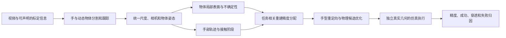

# R4：从视频重建交互对象，验证灵巧操作精度的提升

研究日期：2026-11-01。结论基于论文、作者项目页、仓库与发布说明的阅读，**没有在本机运行这些方法**。2026 年近期 arXiv 工作按预印本看待；仓库可访问、论文有结果与本机可复现是不同状态。当前授权仅研究与环境盘点。

## 1. 结论与范围变化

建议把 R4 的主问题定为：**在相同观察和计算预算下，针对接触区域与任务容差分配重建精度，并显式处理几何不确定性，是否比均匀提高模型精度更能提升实际灵巧操作的成功率和最终精度？**

用户已明确跳过本阶段 R3，推进超出原复现方案的 R4。旧“冻结 SONIC、绕静态箱体伸手”的计划保留为已知几何基线，不再限制 R4 的研究目标。现有工程可复用来源追踪、缓存、时钟、实际状态和失败审计；身体动作接口不会自动提供手指级操作策略。

方向有价值，但“视频 → 手物重建 → 接触优化 → 机器人操作”已经有直接相关工作，不能单凭串接模块宣称原创。最值得争取的贡献是**可检验的几何—操作因果关系、在固定预算下的精度分配方法，以及遮挡/尺度/接触误差下的能力边界**。是否具有论文级新颖性仍需后续更细的算法对比和实验证据。

## 2. 两个指定项目各能提供什么

### VideoMimic：全局人体—场景一致性的参考

单目视频联合恢复人体运动与场景，结合尺度、重力、点云/表面重建和机器人重定向；控制侧包含训练与蒸馏，不是现有 SONIC 的即插即用前端。论文的局部高度图表示适合地形和坐立等全身任务，作者也指出精细交互的表示限制。对本项目最有用的是统一坐标、尺度与场景处理思路；手指接触曲面和动态小物体仍需新的对象级分支。[论文](https://arxiv.org/html/2505.03729v1)、[代码](https://github.com/hongsukchoi/VideoMimic)。

官方配置涉及多个环境：主流程 Python 3.12 / CUDA 12.4+，部分重建 Python 3.10 / CUDA 11.8；已报告测试卡不包括 V100。不能把局部优化器耗时当作全流程时延，也不能把公开视频中的成功视作本机验收。[安装说明](https://github.com/hongsukchoi/VideoMimic/blob/main/real2sim/docs/setup.md)。

### WM-Craftnet：在线多模态状态估计与操作的参考

> 2026-11-02已进一步核验具体源码与权重配置，加入多模态重建/操作实施方案和实验设计，见[后续专项报告](r4-multimodal.zh-CN.md)。此前这里只给候选方向。

它将本体、深度、触觉和动作历史编码进循环潜在状态，辅助灵巧手策略；核心不是从普通视频输出精细物体网格，也不是在想象轨迹中直接规划。可借鉴的是交互中的观测融合与状态修正。论文的物体迁移涉及下游策略学习，不能称为任意物体零样本精密操作。[论文](https://arxiv.org/html/2609.07002v1)、[代码](https://github.com/sharpa-robotics/WM-Craftnet)。

仓库提供训练/评估及权重入口，训练栈为 Python 3.8、Torch 2.1/cu118、Isaac Gym Preview 4。发布的 z 轴权重与当前完整模型预测头配置存在差异，使用前必须匹配；有 checkpoint 不等于已复现全部论文实验。该栈与新重建栈应隔离。[发布说明](https://github.com/sharpa-robotics/WM-Craftnet/blob/main/RELEASE_NOTES.md)。

## 3. 与用户想法更接近的工作

下表只比较技术位置和适用边界，不跨数据集直接排列论文成功率。

| 工作 / 一手来源 | 已覆盖的能力 | 对 R4 的约束与用途 |
| --- | --- | --- |
| [HOLD，CVPR 2024](https://openaccess.thecvf.com/content/CVPR2024/html/Fan_HOLD_Category-agnostic_3D_Reconstruction_of_Interacting_Hands_and_Objects_from_CVPR_2024_paper.html) | 单目手物联合隐式表面重建 | 适合感知对照；重建指标不证明机器人操作精度 |
| [MagicHOI，ICCV 2025](https://byran-wang.github.io/MagicHOI/) | 用 3D/生成先验补充短视频中不充分可见的几何 | 可研究遮挡与补全；生成的背面必须区别于观测支持的表面 |
| [VideoManip，2026](https://arxiv.org/html/2602.09013v1) | RGB 手物轨迹、物体网格/姿态、接触优化与策略学习 | 最直接的端到端对照之一；论文包含策略训练，不能只跑重建就引用其控制结果 |
| [Do as I Do，2026](https://do-as-i-do.com/) | 普通 RGB 视频重建，加采样式物理重定向 | “不用大规模 RL、用物理优化生成手动作”也已有工作，适合作执行基线 |
| [C2Dex，2026](https://arxiv.org/html/2608.07045v1) | 物体坐标系中的稳定接触聚合、重建修正、交互几何重定向与残差优化 | 接触点/SDF/局部交互保持已有系统方法；[代码仓库](https://github.com/K-Jie/C2Dex_code)目前核心发布任务仍待完成 |
| [OmniHOI，2026-10 预印本](https://arxiv.org/html/2610.10855v1) | 遮挡/接触修正、重定向、物理优化，避免每任务 RL | 直接竞争路线；视频评估经过低遮挡/高覆盖筛选，不能推广为任意网络视频可靠 |
| [Hand2Robot，2026-10 预印本](https://arxiv.org/html/2610.15769v1) | 手物对齐、时序姿态选择和交互迁移 | 方法明确使用 RGB-D/内参及后续机器人数据；与纯 RGB 条件必须分组比较 |
| [NeuralFeels，Science Robotics 2024](https://suddhu.github.io/neural-feels/) | 视觉/触觉融合，同时估计未知物体形状和位姿 | “触觉让重建更准确”已有强先例；需要相应传感条件，不能把触觉输入藏进 RGB 基线 |
| [主动触觉重建，2025](https://arxiv.org/html/2505.11975v1) | 根据形状不确定性安排接触并修正局部几何 | 仅增加 uncertainty 或主动触摸不足以构成新意，需证明任务收益与预算优势 |
| [SPIDER](https://github.com/facebookresearch/spider) | 多种手型上的物理重定向，公开代码/数据 | 可提供执行侧对照；不负责原始视频的未知物体重建，当前依赖也未在本机验证 |

三个具体警示：

- VideoManip 作者仓库当前发布了重建流程，而抓取学习和操作策略流程尚未完整发布；其重建第 6 阶段涉及付费 API，第 7 阶段依赖 FoundationPose 容器。后续若用全本地替代模块，需要标为改动基线，不能声称精确复现原系统。本轮没有调用 API 或启动容器。[仓库状态](https://github.com/hychen-naza/VideoManip)、[阶段说明](https://github.com/hychen-naza/VideoManip/blob/main/reconstruction/README.md)。
- OmniHOI 的视频结果是筛选后的 60 段，报告 53% 成功；其失败中感知与执行都占重要部分，并明确存在物体尺度问题。这支持继续研究，但不支持“精细重建问题已解决”或“已经达到毫米级”。相关数字只适用于它的实验条件。[论文实验与局限](https://arxiv.org/html/2610.10855v1)。
- SPIDER 当前依赖 Python ≥3.12、MuJoCo/Warp 等新版本；它的可用代码比尚待发布的算法更利于工程起步，但仍不能保证 V100/驱动 530/旧 glibc 可直接运行。代码采用 CC-BY-NC-4.0，应与其他模型、数据的许可分别记录。[配置](https://github.com/facebookresearch/spider/blob/main/pyproject.toml)、[仓库](https://github.com/facebookresearch/spider)。

## 4. 真正需要解决的技术链

图为拟研究接口，不代表模块已经实现；执行端的独立真值仅用于评价。以后若使用在线深度/触觉反馈，应另列输入分组，不把测试真值通过反馈送给规划器。

**场景与对象分层。** 背景只需足以处理碰撞与支撑的粗几何；被操作对象需要独立运动轨迹、规范物体坐标和细表面。把整个动态视频融合成静态场景会混入移动手/物体和重影。优先对象级网格或 SDF；NeRF/3DGS 的渲染质量可用于诊断，但高 PSNR 不保证碰撞表面、薄壁或孔洞正确。

**把“细粒度”定义成可测量量。** 应关心把手内径、杯沿厚度、槽宽、指尖接触法向、局部间隙等与任务约束有关的几何，而不是三角面数。尺度、位姿和控制误差必须一起计入：例如 100mm 长度的 1% 尺度误差已有 1mm；50mm 杠杆臂上的 1° 旋转误差约为 0.87mm。即使网格很细，整体误差预算仍可能不允许毫米级插接。

**单目尺度存在可观测性边界。** 没有标定或已知长度锚时，整体几何与相机距离同比缩放可产生相同投影。人体尺寸、类别常识和生成模型只能给先验，不能保证毫米级绝对尺度。应把纯RGB、RGB+尺度锚、RGB-D分别评估；如果高精度只在增加测量后成立，就明确报告这个条件。

**接触和遮挡互相约束，但也会互相放大错误。** 手指投影重叠不是可靠接触真值；需要时间一致性、表面法向、相对速度等证据，并保留多种姿态/对称性假设。用“更容易完成动作”反过来调整网格会产生自我迎合的物体，因此重建与评价必须有独立观察或真值约束。

**视觉网格与碰撞几何分开验证。** 细节经过凸分解或简化后，孔洞、凹槽和薄壁可能在仿真碰撞代理中消失。需要记录两种几何的偏差，固定接触模型、步长和求解器条件；不能让更好的渲染表面搭配同一个粗碰撞盒，再把操作无改善归因于重建无用。

**形状、姿态、物性分开。** RGB 很难独立确定摩擦、质量、柔顺性和被遮住的结构。第一阶段可把物性固定为声明的条件，另做扰动敏感性；不能把已知物性写成从视频恢复的能力。透明、反光、细绳和可变形物体单列挑战范围。

## 5. 建议主攻的研究假设

### H1：任务相关局部精度优于均匀增加细节

从粗模型出发，依据候选动作的接触区域、目标容差与误差传播，决定在哪些区域增加视角/关键帧、优化迭代或局部 SDF 分辨率。区别于单纯“接触处更密”的目标是：**比较一次重建操作预计减少多少执行失败或目标误差，再决定是否值得花预算。**

可以先使用解析敏感度和候选扰动估计，避免先引入需要训练的风险网络。候选排序的一种设计是：任务误差对局部几何的敏感度 × 校准后的几何不确定性 ÷ 新增计算成本。该形式是待检验假设，不能仅凭形式声称原创或保证有效。

### H2：多几何假设能减轻错误补全造成的操作失败

对未见表面保留多个合理形状/尺度/姿态假设，区分“视觉真实支持”与“生成先验推断”。候选动作在这些假设上评估风险与任务达成；比较单一最佳重建与多假设方法。必要时输出信息不足或请求更有价值的观察，但拒绝率必须统计，不能只对敢做的样例报成功率。

需要与已有主动感知/不确定性方法比较；研究重点应落在**有限观察条件下的任务容差与接触风险**，不是“首次使用不确定性”。

### H3：视频先验与交互反馈的收益可以分离

先用视频提供形状/接触阶段先验，再研究仿真深度或触觉反馈如何修正局部形状/姿态。设置无反馈、仅视觉、视觉+触觉，以及只改姿态/同时改形状的消融。WM-Craftnet 可作为循环状态融合思路，NeuralFeels 可作为形状融合参考；将两者接上仍需新的实验证明。

这一阶段的传感输入均可来自仿真，因此跳过现场相机 R3 不阻止研究；但任何真实机器人验证仍在本项目当前授权之外。训练残差策略或新的风险模型仅为未来候选，本轮未获训练授权。

## 6. 起步任务与能力推进

建议先固定一种有公开仿真资产的手型，建立独立灵巧手执行分支，之后再接手臂和 G1 全身。不要要求尚未支持精细手指动作的身体模仿接口承担所有新能力。

| 阶段 | 任务 | 主要检验什么 |
| --- | --- | --- |
| A | 刚性不对称物体的精确抓取、手内转向与定向放置 | 局部接触法向/尺度/姿态是否改变滑落和最终目标误差 |
| B | 有边沿、把手、凹槽或孔的对象；接近指定槽位/容差放置 | 全局形状相似时，关键细节是否决定可操作性；必须给出明确间隙条件 |
| C | 瓶盖/按钮等关节对象、工具尖端交互 | 同时涉及部件运动、任务关系和接触状态；另行冻结模型与评价，不混入刚体结果 |
| 挑战集 | 遮挡、少视角、对称、薄壁、反光、可变形 | 画出失败边界；不把挑战样例失败藏掉或临时换样本 |

初始开发可用 3–5 个对象定位问题，随后按对象实例/类别、视频来源、任务划分独立测试。正式数量和容差应在开发阶段根据可观测性与成本冻结，不凭本次阅读指定一个未经校准的“成功率必须提升 X%”。浮动手基座的成功也不能当作手臂可达或全身稳定，后续须分别加入关节/力矩与支撑约束。

## 7. 能建立因果关系的对照

| 对照 | 固定什么 | 所区分的解释 |
| --- | --- | --- |
| 粗模型 / 全局加细 / 接触区加细 / 不确定性选区 / 任务敏感度选区 | 同一视频、姿态估计、手型、控制权重、优化预算 | 改进是否来自任务相关几何分配 |
| 估计几何 + 估计姿态；真值几何 + 估计姿态；估计几何 + 真值姿态；两者真值 | 同一控制器和评价环境 | 形状、尺度/姿态与控制各自造成多少损失；oracle 仅作诊断上界 |
| 固定控制器 / 新控制器 × 基础重建 / 新重建 | 同一数据与总预算，分开报告 2×2 组合 | 防止把控制改进全部归功于几何 |
| 单假设 / 多假设 / 多假设+新增观察 | 同一初始可见内容，并记录新增观察成本 | 鲁棒性来自更好的推理还是额外信息 |
| 无反馈 / 视觉 / 视觉+触觉 | 除声明传感模态外同条件 | 反馈增益与视频重建增益分开 |

**最关键的评价隔离：规划用重建物体，执行用独立真值物体。** 如果两边都使用同一个错误网格，穿透、孔洞和尺度错误可能被“自洽”地隐藏。可先用程序生成的真值物体渲染视频，规划器只接触图像；再用带独立扫描/标定的真实视频检查域差异。公开 CAD/深度可作为评价真值，但输入它们就必须改称已知几何/RGB-D 实验。

计费与资源对照应包括全部预处理、失败尝试、优化、物理 rollout、GPU 时间、显存峰值和存储；不能只比较最终控制的毫秒数。墙钟比较使用同一块已确认空闲的 GPU；多卡吞吐单独报告。

## 8. 指标与失败归因

- **几何：** 接触/功能区域的表面距离（mm）、法向误差、孔/槽/薄壁尺寸误差；整体 Chamfer/F-score 辅助报告，不能独占结论。
- **状态：** 绝对尺度误差、物体 6D 位姿、时间连续性、接触阶段识别；对称对象使用事先声明的等价姿态规则。
- **执行：** 任务成功率、目标平移/转角误差、稳定持握时长、滑落、最大穿透及持续时间、关节/力矩越界、拒绝率。
- **可信度：** 可见/未见表面分组，不确定性与真实误差是否校准；生成补全的视觉质量不能替代几何精度。
- **统计：** 同对象配对比较，按对象而不是逐帧计算独立样本；报告置信区间、多次随机种子和完整失败分母。

候选误差扫描可包括 0.5/1/2/5mm 局部扰动、尺度扰动与遮挡比例，但这是实验设计范围，不代表本系统达到相应精度。按分割、重建、位姿、接触、重定向、物理执行分层归因。没有显著增益时保留否定结果，判断瓶颈是否在控制或状态估计。

## 9. 数据与复现资源

| 来源 | 优先用途 | 隔离与准备事项 |
| --- | --- | --- |
| [DexYCB](https://dex-ycb.github.io/) | 标定手物视频、几何/姿态与接触诊断 | 只取单路 RGB 作纯视频输入，其他模态/CAD 留作评价；全集压缩约 119GB，可按 subject 子集开始；CC-BY-NC-4.0 |
| [HOT3D](https://github.com/facebookresearch/hot3d) | 自我视角和多视角遮挡分析 | 先选片段；多视角辅助输入与单目实验分开，按实际数据许可准备 |
| [ARCTIC](https://arctic.is.tue.mpg.de/) | 第二阶段双手/关节物体研究 | 需要关节和接触评价，资产访问与条款独立核对，不能沿用刚体成功定义 |
| [NeuralFeels / FeelSight](https://github.com/facebookresearch/neuralfeels) | 视觉触觉形状/姿态分项研究 | 不作为纯 RGB 基线；传感器与触觉表征差异要记录 |
| 自建程序化物体/视频 | 可控几何误差、尺度与遮挡扫描 | 物体生成 seed 与测试实例冻结；规划器不读取真值场景文件 |

先做小规模、可归因的子集，不下载全部研究数据。MANO/SMPL 等受限模型、各重建权重、SDK 和数据集的许可证分别管理；仓库代码开放不代表资产都可重新分发。

## 10. 本机可行性与下一轮交付

4 × V100 32GB 适合考虑串行重建和多个独立候选/种子，但性能尚未测量，不能承诺某论文时长或任意模型可装入显存。更迫切的限制是 Volta 架构、Ubuntu 18.04/glibc 2.27、驱动与包组合、Docker 权限和系统盘空间，见 [本机盘点](server-readiness.zh-CN.md)。优先单卡基线，然后才做并行隔离；已有占用的 GPU 0 不作为默认空闲资源。

建议下一轮在授权安装/运行后交付：一个可用的手型物理基线；一个保持输入/资产可追溯的本地视频重建基线；一组固定控制器下的几何误差—操作误差曲线；再据瓶颈确定 H1/H2 的实现和正式保留集。需要调用付费 API、训练或真机的路线不能被本次研究自动放行。

当前完成的是研究和迁移决策材料。R4 源码、目标硬件运行、精度提升和原创性验证均为 `awaiting_verification`；R3 按用户要求本阶段跳过，R1/R2 原机结果保持历史有效。
