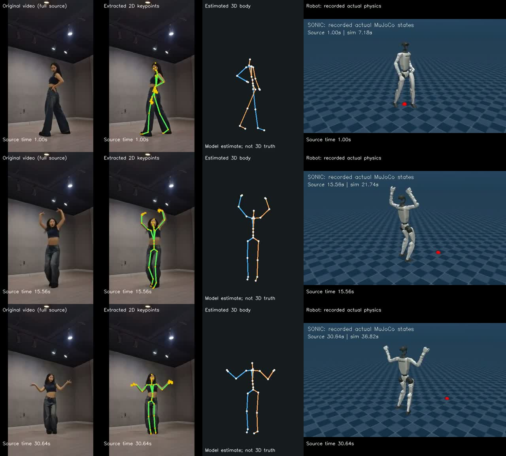

# Results, including the failures

[Home](../README.md) / Evidence

**Updated: November 4, 2026.** R1/R2 below preserve engineering acceptance from the original RTX 4060 Laptop environment. R4 component evidence comes from the V100 server. R1 uses fixed official/debug examples; R2 uses five debug and five held-out videos with narrow input conditions. Neither is a broad generalization benchmark.

## R1 — Reference tracking

**10/10 trials passed; all five motions passed twice.** All 6,300 control samples are retained. Per-trial joint RMSE spans **0.10875–0.17517 rad**, below the predeclared 0.35 rad gate. Gravity, contact and a free root remain enabled; actual state is not overwritten with reference poses.

| Motion | Trial 1 RMSE (rad) | Trial 2 RMSE (rad) | Outcome |
| :--- | ---: | ---: | :--- |
| Macarena | 0.13378 | 0.13409 | 2/2 passed |
| Dance in da party | 0.17270 | 0.17517 | 2/2 passed |
| Squat | 0.13419 | 0.13121 | 2/2 passed |
| Walking quip 360 | 0.10918 | 0.10875 | 2/2 passed |
| Forward lunge (mirrored reference) | 0.13415 | 0.13574 | 2/2 passed |

[Accepted R1 evidence and artifact hashes](../evidence/r1-acceptance-20261029.json) · [Frozen motion list](../configs/r1-suite.json)

The initial 3/10 failed batch and an interrupted batch remain in the history and are excluded from the accepted batch. The accepted trials share one frozen runtime identity; results from different driver versions were not pooled. [What changed and what can be inferred](insights.md#02--the-clock-belongs-in-the-control-experiment)

## R2 — Recorded-video imitation

**4/5 held-out videos passed**, meeting the original at-least-4/5 gate. Debug results are **3/5 passed**. All ten current rollouts completed their physical path stably, consuming **12,095 source references** in total. Physical stability does not imply correct imitation: three videos still failed event checks.

| Split | Source | Action class | Motion events | Physical execution | Full outcome |
| :--- | :--- | :--- | :--- | :--- | :--- |
| debug | [QqvZAUEOrAQ](https://www.youtube.com/watch?v=QqvZAUEOrAQ) | dance | 6/6 | passed | **passed** |
| debug | [0EpP3pYUYTk](https://www.youtube.com/watch?v=0EpP3pYUYTk) | lower body | 7/7 | passed | **passed** |
| debug | [vTx_ldn6MCA](https://www.youtube.com/watch?v=vTx_ldn6MCA) | upper body | 3/4 | passed | **failed** |
| debug | [6uqztDO_7kQ](https://www.youtube.com/watch?v=6uqztDO_7kQ) | stepping | 0/6 | passed | **failed** |
| debug | [2e_7XBmpw14](https://www.youtube.com/watch?v=2e_7XBmpw14) | dance | 5/5 | passed | **passed** |
| heldout | [ROZy7jawHf4](https://www.youtube.com/watch?v=ROZy7jawHf4) | trunk | 8/8 | passed | **passed** |
| heldout | [U7Nrwyu6Uqo](https://www.youtube.com/watch?v=U7Nrwyu6Uqo) | lower body | 6/6 | passed | **passed** |
| heldout | [gRexOgq8h-8](https://www.youtube.com/watch?v=gRexOgq8h-8) | dance | 6/6 | passed | **passed** |
| heldout | [dIfUVvoVXRM](https://www.youtube.com/watch?v=dIfUVvoVXRM) | dance | 5/5 | passed | **passed** |
| heldout | [GP4YqDYMmcI](https://www.youtube.com/watch?v=GP4YqDYMmcI) | dance | 5/6 | passed | **failed** |

[Accepted R2 evidence and artifact hashes](../evidence/r2-acceptance-20261101.json) · [Frozen source/event manifest](../configs/r2-suite-frozen-20261101.json)

All 50 output MP4 files were fully decoded and bound to artifact hashes in the acceptance review. This is a media-integrity result, not 50 independent trials. The five held-out sources have all been used. Three held-out dance sources share a creator, so the split has correlated content and limited diversity. New tuning requires a new predeclared test split.

### Failures remain part of the result

- **Arm circles (debug): 3/4 events.** The final right-arm lowering did not reach the fixed amplitude criterion.
- **Stepping (debug): 0/6 events.** The final initialized rollout was stable but did not satisfy the frozen stepping-event checks. Its earlier 22/574-reference fall remains a separate failed attempt.
- **Dance GP4YqDYMmcI (held-out): 5/6 events.** The wide-crouch left-knee threshold was 0.7 rad; the estimate reached about 0.48139 rad and the robot 0.41443 rad. The deficit was already present in the reference. Its cause has not been independently isolated; thresholds and side labels were not changed after testing.

## How to read the demonstration

The preview samples the beginning, middle and end of the complete 31-second source [gRexOgq8h-8](https://www.youtube.com/watch?v=gRexOgq8h-8). Original footage belongs to its creator. The robot image is rendered from recorded actual states after physical execution; it is not a reference-pose animation. Estimated 3D body positions are not human ground truth. The comparison preserves visible pose and phase differences.

The homepage's [single-frame image](assets/demo-frame.jpg) is extracted at comparison time 15.56 seconds from the same full MP4. It is a static preview, not a new experiment. [Preview provenance](assets/provenance.json)

## Full media on the execution machine

Raw reports, inputs and full videos are intentionally not tracked in Git. The paths below are **local artifact locations**, not downloadable GitHub links. Each hash is recorded in the tracked acceptance JSON above.

R1 suite root: `runs/r1-suite-acceptance-20261029-03/`. Each trial directory contains `REPORT.md`, `actual-state.npz`, native controller logs and `actual-execution.mp4`.

R2 suite report: `runs/r2-suite-acceptance-20261101-01/REPORT.md` (the local link resolves into the D-drive storage root). Per-source directories under `/mnt/d/humanoid-demo-r2/runs/`:

| Source | Run directory | Comparison |
| :--- | :--- | :--- |
| QqvZAUEOrAQ | `r2-debug-init-QqvZAUEOrAQ-20261101-01` | `demo/comparison.mp4` |
| 0EpP3pYUYTk | `r2-debug-init-0EpP3pYUYTk-20261101-01` | `demo/comparison.mp4` |
| vTx_ldn6MCA | `r2-debug-init-vTx_ldn6MCA-20261101-01` | `demo/comparison.mp4` |
| 6uqztDO_7kQ | `r2-debug-init-6uqztDO_7kQ-20261101-01` | `demo/comparison.mp4` |
| 2e_7XBmpw14 | `r2-debug-init-2e_7XBmpw14-20261101-01` | `demo/comparison.mp4` |
| ROZy7jawHf4 | `r2-heldout-ROZy7jawHf4-20261101-01` | `demo/comparison.mp4` |
| U7Nrwyu6Uqo | `r2-heldout-U7Nrwyu6Uqo-20261101-01` | `demo/comparison.mp4` |
| gRexOgq8h-8 | `r2-heldout-gRexOgq8h-8-20261101-01` | `demo/comparison.mp4` |
| dIfUVvoVXRM | `r2-heldout-dIfUVvoVXRM-20261101-01` | `demo/comparison.mp4` |
| GP4YqDYMmcI | `r2-heldout-GP4YqDYMmcI-20261101-01` | `demo/comparison.mp4` |

Each R2 package also retains source, extraction and robot panels; source hashes and timestamps; GEM-X/SOMA outputs; converted references; actual states; body/event evaluation; timing and visual audits. Consult the tracked acceptance JSON for exact original and supplementary audit paths, including failures.

## Acceptance boundaries

| Evidence layer | Status |
| :--- | :--- |
| Source/environment checks on the accepted workstation | `passed` |
| R1/R2 headless closed-loop simulation | `passed` within the stated suite gates |
| Recorded actual-state offline playback | `passed` |
| GPU-accelerated graphical window | `awaiting_verification` |
| R3 on-site camera, freshness, recovery and latency | Skipped for this stage; historically unverified |
| R4 sensing, CUDA joint estimation, memory/control | Implemented; targeted V100 engineering checks passed |
| R4 successful manipulation and local-geometry gains | `awaiting_verification`; complete video frontend and experimental comparison remain open |
| Independent R4 Linux/V100 rebuild | Passed: clean committed checkout, hashed empty-prefix installation, CUDA first run and runtime regressions; see [delivery evidence](../evidence/runtime-portability-20261102.json) |

The completed experiments used no newly billed cloud resources; that does not make local computation free. No real robot or new training is included. The R4 runtime is independently prepared on the server; R1/R2 full pipeline migration is not established by it. [Current plan](../PLAN.md) remains the execution authority.

The 2026-11-01 server inventory and research review are preparation evidence, not new robot results. See [server readiness](server-readiness.zh-CN.md) and [research](research.md); the accepted execution results above remain from the original workstation.

## R4 — generated example and current component evidence

The stable [setup](getting-started.md#prepare-a-runtime) and [example](usage.md#cuda-example-and-results) paths build a separate Linux/V100 prefix and generate observations without private assets. A completed example produces a coarse/estimated surface illustration, estimated state/covariance and independent analytic metrics. `execution_status`, `task_status` and `acceptance_status` are separate; an exit-0 run is not a successful grasp claim.

The November 2 research review fixes exclude internal union faces from geometry metrics, remove continuous-force information from the binary baseline, and freeze independent per-frame poses for shape-only evaluation. [Review evidence](../evidence/r4-review-fixes-20261102.json) records 15 targeted, 15 P2 and 18 memory/control checks. [Earlier online evidence](../evidence/r4-memory-control-20261102.json) records an actual LEAP negative control: execution completed, task failed as expected. Neither establishes a geometry-induced operation gain; the later calibration below has a narrower, explicitly stated scope.

The [runtime-portability delivery](../evidence/runtime-portability-20261102.json) records the independent rebuild from 57 hashed wheels, eight environment/CLI checks, six installer contracts, targeted 15/15 and P2 15/15 CUDA regressions, and a fresh six-check LEAP force-bridge run with NVIDIA EGL. The generated example has translation RMSE 0.0194 mm, surface RMSE 0.0260 mm and compliance error 0.0555 mm/N on its analytic fixture. Its pose interval does not cover the fixture error; these numbers do not establish calibrated uncertainty or operation accuracy. Ordinary inspection returns 0 and strict acceptance inspection returns 3 for the same saved result.

Historical metrics above are not replaced by new environment runs. Raw installation, example, force-calibration video and audit outputs live in `runs/runtime-portability-20261102-01/`; [PLAN](../PLAN.md) is the current authority. Website links and HTML structure were checked; browser rendering and remote publication were not performed in this delivery.

## R4 — November 3 prerequisite results

The [prerequisite summary](../evidence/r4-prerequisites-20261103.json) records the latest frozen V100 evidence. Numerical estimation and hand kinematics use CUDA; MuJoCo dynamics run on the CPU and rendering uses NVIDIA EGL. These are simulation results, with no real-robot or live-camera acceptance.

| Evidence | Result | Limit |
| --- | --- | --- |
| LEAP force bridge / P2 joint estimator / memory, control and probes | `passed`: 6 / 15 / 31 CUDA checks | Module behavior, not successful manipulation |
| Full-hand loading at the calibration posture | `passed`: 20 fit + 20 separate verification trials; conservative local compliance bound about 0.1214 mm/N | Hand/probe response, not object material or arbitrary grasp posture |
| Conditional translation confidence | `passed`: 18/20 independent verification trials covered, after 20 fit trials; frozen interval multiplier 60.4293 | Two development objects and a fixed time window; multiplier is offline only, not applied to online covariance |
| Analytic joint confidence fixture | `passed`: 20/20 simultaneous final-frame xyz/scalar-compliance coverage | No rotation and no physical LEAP object-compliance validation |
| Earlier U-shaped object reference | T1 held 7.48 s; T2 errors 3.763 mm / 1.944 degrees | Exceeds the current 2 N force bound and predates controller changes; not an eligible E3 reference |
| Current bounded grasp/place reference | `failed` / `awaiting_verification` | No accepted T1/T2 under the current force bound; no demonstrated geometry or active-probing gain |
| Current online negative control | Execution `passed`, task `failed`; 4 s and 101 recorded frames | Confirms the isolated observation-to-estimator-to-control path only |

All three prerequisite cohorts have finished. Total charged occupancy is 3.0270 GPU-hours, with no billed cloud spend or learned-policy training. The overnight cohort has 139 commands and retains an overall `failed` status because four grasp candidates were rejected for missing the required two-finger load. These rejections are not erased by the calibration passes. E3 remains gated on accepted manipulation references and complete calibration; 24 held-out objects remain unused.

Raw outputs, private evaluation, videos and failure logs are retained in `runs/r4-prerequisites-live-20261103-01/` and `runs/r4-prerequisites-overnight-20261103-02/`; large media are not included in Git. The [video-learning comparison](research-video-interaction.zh-CN.md#11-视频学习操控的候选实现与复现难度2026-11-04) is a source review, not an additional runtime result.
