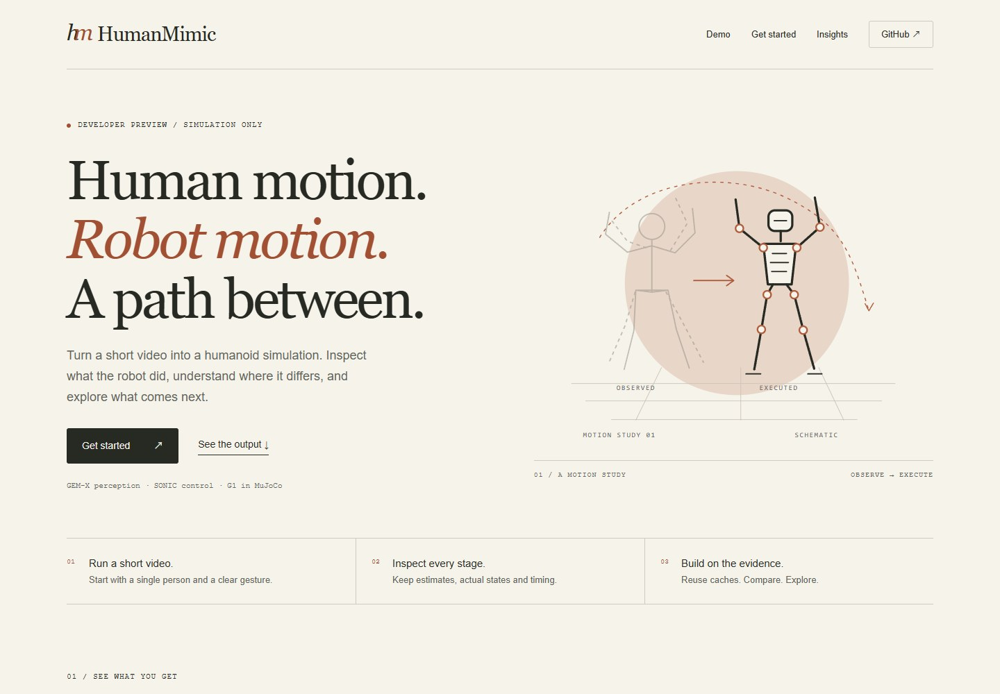

# Website design and local preview

[Home](../README.md) / Website

**Status: local preview; no hosted website deployed.** The site combines practical onboarding with insights from execution. It uses the same capabilities, limitations and evidence as the GitHub homepage.



## Visitor journey

1. **Understand the purpose.** Video to humanoid motion, with a clear Get started action and a real-output link.
2. **See the output.** An actual comparison frame, attribution, and explanations of the video, intermediate data and report.
3. **Get started.** Source, input inspection and output recipes; environment preparation and troubleshooting are adjacent.
4. **Understand the pipeline.** Perception, reference, frozen control and physical execution, with inspectable boundaries.
5. **Explore insights.** Short observations with implications and links to deeper notes.
6. **Inspect results.** R1/R2 summaries and an expandable table of all ten video outcomes, including failures.
7. **Follow the open question.** Proposed scene adaptation, explicitly separate from implemented capabilities.
8. **Take a next step.** Start a run on a prepared target, read usage guidance, or contribute a fix or idea.

The page does not run inference, upload clips or install a runtime. The copy controls copy literal commands. Manual setup and current migration readiness remain visible in the onboarding section. A static comparison frame is labeled as such; it has no pretend play control.

## Visual direction

Warm paper, dark ink, large serif headings, small monospaced labels, fine rules and a restrained terracotta accent. Original line drawings introduce the subject; real output makes the capability concrete. Generous spacing and concise editorial rows support both scanning and deeper reading.

The user-selected references were reviewed on November 1, 2026:

| Reference | Direction used for HumanMimic |
| :--- | :--- |
| [Physical Intelligence](https://www.pi.website/) | Sparse navigation, restrained metadata, clear article entries and room around the content |
| [Anthropic](https://www.anthropic.com/) | Warm neutral surfaces and strong typographic hierarchy across product and research content |

These are aesthetic references, not affiliations. Company logos, copy, proprietary fonts and illustrations are not reused. The motion-study and pipeline SVGs are original repository assets.

| Token | Value | Use |
| :--- | :--- | :--- |
| Paper | `#f6f3eb` | Main background |
| Ink | `#272923` | Text and primary actions |
| Muted | `#64665b` | Supporting text |
| Rule | `#cfccbf` | Dividers |
| Terracotta | `#a15033` | Emphasis and selected controls |
| Sage | `#e9ecdf` | Getting started section |
| White | `#fffdf8` | Commands and demo caption |
| Display | Georgia → Times New Roman → serif | Headlines |
| Body | Arial → Helvetica → sans-serif | Reading text |
| Metadata | Courier New → monospace | Steps, dates and commands |
| Content width | `1248px` maximum | Desktop composition |

Fonts are local system fonts. There are no font downloads, analytics, backend requests or runtime dependencies.

## Preview locally

Open [website/index.html](../website/index.html) directly in a browser for an offline preview, keeping the repository directory structure intact. Clipboard access depends on the browser; if unavailable, the copy button selects the command for manual copying.

For an HTTP preview, run from the repository root:

```bash
python3 -m http.server 8000 --bind 127.0.0.1
```

Open `http://127.0.0.1:8000/website/` on the same machine. Remote machines need supported forwarding. Serve the repository root so shared `docs/assets/` references resolve. Stop the server with Ctrl+C after previewing.

Documentation links point to the private GitHub repository and require access. The preview does not alter that audience.

## Implementation and interaction

| File | Responsibility |
| :--- | :--- |
| [index.html](../website/index.html) | Content, recipes, actual-output preview, results and navigation |
| [styles.css](../website/styles.css) | Tokens, typography, surfaces and responsive layout |
| [script.js](../website/script.js) | Recipe tabs, command copy/fallback, result filters and status announcements |
| [Shared assets](assets/) | Original SVGs and attributed output frame |
| [Asset provenance](assets/provenance.json) | Frame identity and current preview capture |

Recipe tabs support arrow keys and Home/End, with correct selection/focus state. Copy controls report success only after clipboard writing succeeds and otherwise select the text. Result filters update a polite live count. Native details controls expose runtime requirements and the full results table.

Without JavaScript, all three recipes remain readable, the full table can still be expanded, and unavailable copy/filter controls stay hidden. The page includes a skip link, visible keyboard focus, image descriptions and reduced-motion support. Wide code, diagrams and tables scroll inside their containers instead of widening the page.

## Evidence and maintenance

The HTML results are a static snapshot of [R2 acceptance](../evidence/r2-acceptance-20261101.json), not a live service. Keep every row, event count and outcome aligned with that snapshot. Preserve failures and used-test-data disclosures. Update the date, counters, README and results document only when a new accepted snapshot exists.

Local layout and interaction validation is recorded under `runs/website-usability-20261101-01/`; its compact summary is [website preview verification](../evidence/website-usability-20261101.json). This verifies the presentation, not a new model, controller, camera or server deployment.

## Later hosting

Choose the audience and destination before publication. Full recordings remain on the workstation; the preview includes a small attributed still. Confirm media rights and make documentation accessible to the intended audience before a public release.

Package only `website/` and the referenced `docs/assets/`, preserving the relative structure or rewriting asset paths. Do not use the repository root as a production document root: it contains internal plans and ignored local artifacts. Set canonical and social metadata after the final URL is known. Verify the packaged site and actual deployment separately.
